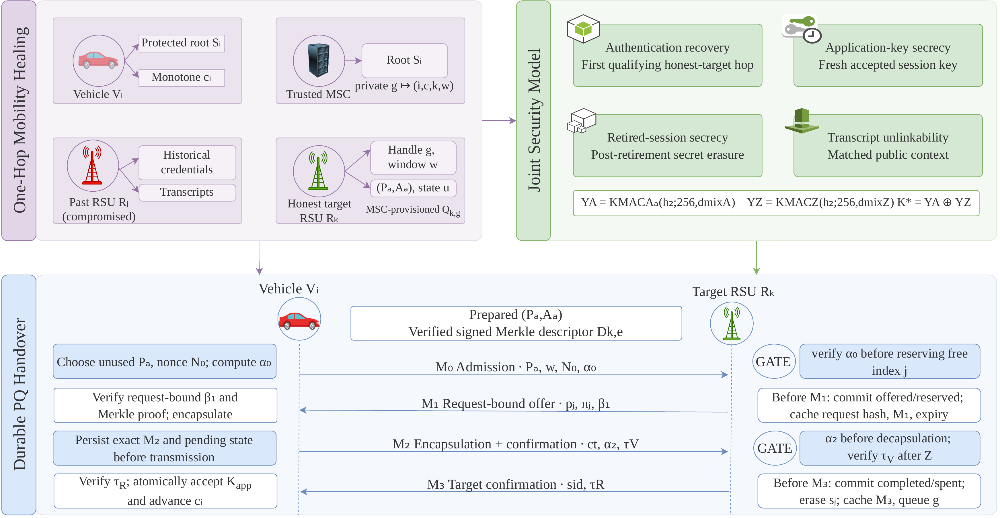
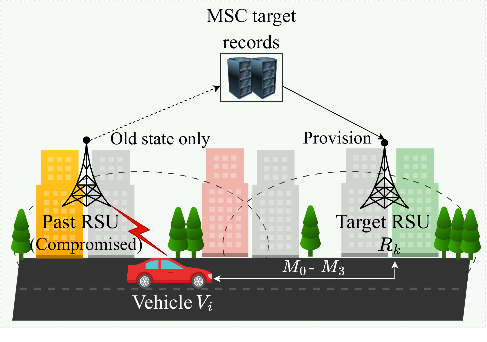
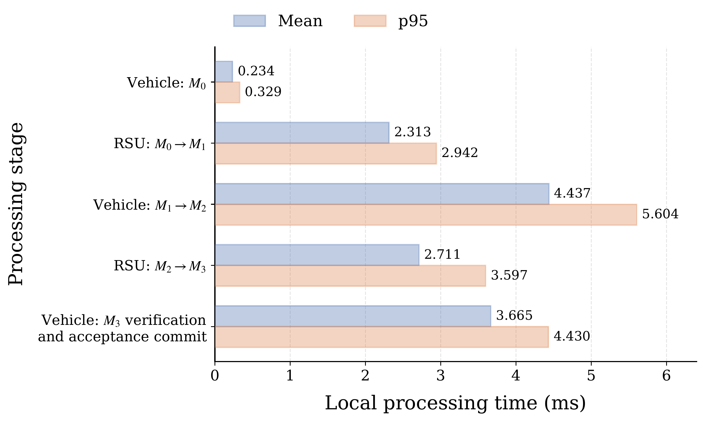
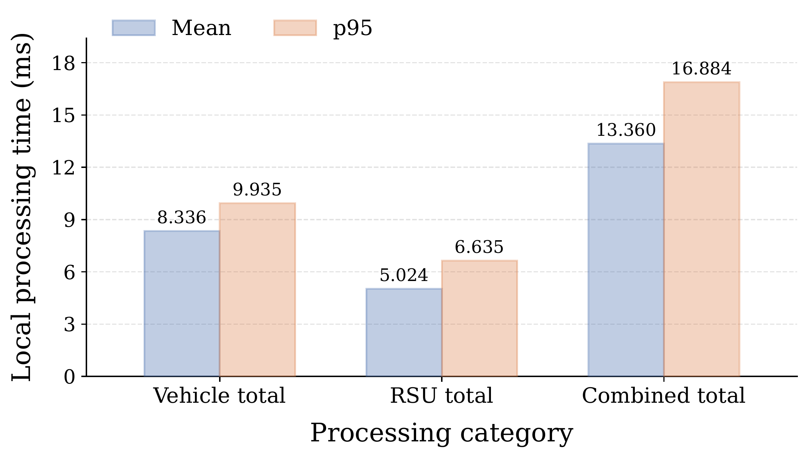
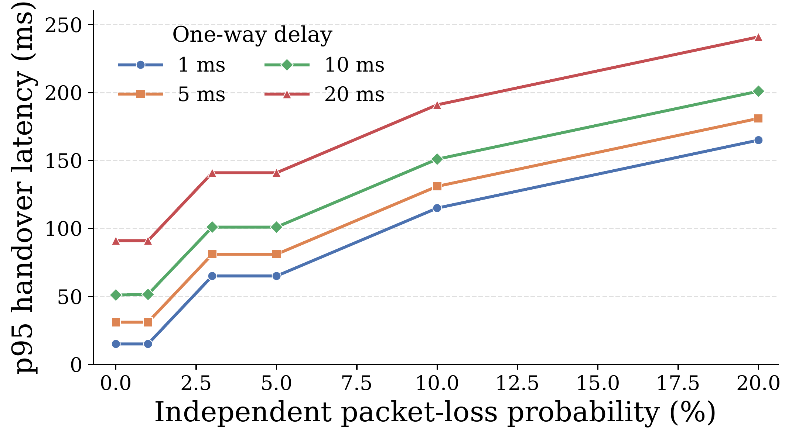
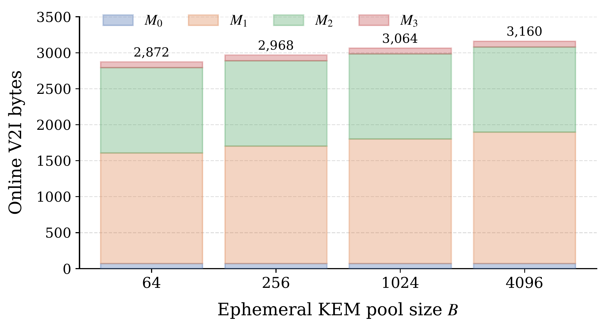

# MobiHeal: One-Hop Compromise Recovery for Post-Quantum Vehicular Handover

**Research documentation and reproducibility resources for target-isolated authentication, post-quantum key establishment, transcript privacy, and crash-safe vehicular handover in the Internet of Vehicles (IoV).**

> **Research manuscript:** *MobiHeal: One-Hop Compromise Recovery for Post-Quantum Vehicular Handover*  
> **Authors:** Anam Nasir, Uddin Md. Borhan, Arif Raza, Xiang He, and Zhongjie Wang  
> **Core construction:** target-specific KMAC256 credentials, ML-KEM-768 session entropy, ML-DSA-65-signed Merkle key pools, request-bound offers, and durable single-use state  
> **Repository contents:** one consolidated experimental notebook, two architecture figures, four evaluation figures, this README, and an MIT license  
> **Evidence rule:** manuscript-reported measurements, new notebook measurements, formal-model verdicts, simulations, and analytical byte counts are identified separately.

## Overview

Vehicle-to-infrastructure (V2I) communication involves frequent transitions between roadside units (RSUs). A compromised RSU may expose its authentication records, cached transcripts, application keys that have not been erased, and unused or un-erased ephemeral key material. Those disclosures can remain useful after a vehicle leaves the compromised RSU unless the next handover is designed to isolate authorization and derive a fresh session key.

**MobiHeal asks whether the first *qualifying completed* handover to an independently provisioned, uncompromised target RSU can recover vehicle authentication and application-key secrecy without a synchronous Mobility Security Controller (MSC) round trip.** The recovery condition is specific: the new target must have an unexposed authorization record and an unexposed ephemeral ML-KEM key, and the challenged vehicle/controller root must remain protected under the security experiment's freshness rules. A failed handover, a compromised new target, or a transition using exposed target secrets is **not** a healing point.

The design integrates three research contributions:

1. **Target-isolated mobility authentication.** The vehicle and MSC derive a different pseudonym/authenticator group for each target, window, counter, and allowed attempt. An old RSU's stolen state does not authorize the same vehicle at a separately provisioned target.
2. **An exposure-aware post-quantum security model.** Independently generated ML-KEM-768 entropy is combined with target-specific authentication material. The manuscript separately scopes one-hop authentication recovery, application-key secrecy, retired-session secrecy, and matched-context transcript unlinkability.
3. **Durable, authenticated four-message handover.** A signed Merkle pool authenticates one-time KEM offers, a request-bound `β₁` tag prevents stale-offer substitution, `α₀` and `α₂` gate expensive work, and persistent irreversible transitions protect retransmissions and restarts.

The current paper evaluates **the request-bound `β₁` four-message implementation**, including key-index/reply-cache persistence. An additional configuration evaluates AES-GCM-wrapped application-session storage and pending MSC-report persistence. The repository notebook aims to reproduce the experimental *methods and trial counts*, but freshly executed timings and model verdicts must be reported as new results rather than substituted for the manuscript values.

### At a glance

| Aspect | Current MobiHeal manuscript | Scope or qualification |
|---|---|---|
| Healing distance | **One qualifying honest-target handover**, `d_heal ≤ 1` | Only after a completed, fresh session at an independently provisioned honest target |
| Authentication records | Target-bound `(Pₐ, Aₐ)` derived with **KMAC256** | A compromised target's own authenticator is not protected against that target |
| Post-quantum key establishment | **ML-KEM-768** independently generated one-time pairs | Unexposed KEM secret and appropriate secret erasure required |
| RSU authentication | **ML-DSA-65** certified, signed Merkle descriptor and Merkle proof | Descriptor, certificate, epoch, expiry, and revocation checks are prerequisites |
| Fast handover | Four messages, **`M₀`–`M₃`** | Target provisioning and descriptor verification happen before the fast path |
| Offer authentication | Request-bound **128-bit `β₁`** | Current `M₁` format includes the tag |
| Mean local processing (`B=1024`) | **13.360 ms** | Manuscript measurement, not radio-inclusive delay |
| Mean vehicle / RSU processing | **8.336 / 5.024 ms** | Manuscript measurement |
| Warm-cache V2I payload (`B=1024`) | **3,064 bytes** | Four protocol messages; excludes link/PHY headers, descriptor acquisition, and retransmissions |
| Offer and completion commits | **75.3% of RSU processing** | Reported persistence-related processing share |
| Modeled completion at 20% packet loss | **96.665%** | Independent-loss Monte Carlo, not a real-radio guarantee |

---

## Contents

- [Methodology and trust architecture](#methodology-and-trust-architecture)
- [Protocol walkthrough](#protocol-walkthrough)
- [Security experiments and assumptions](#security-experiments-and-assumptions)
- [Repository structure and code tour](#repository-structure-and-code-tour)
- [Requirements and installation](#requirements-and-installation)
- [Quick start and reproducibility notebook](#quick-start-and-reproducibility-notebook)
- [Figures and graphs: descriptions and interpretation](#figures-and-graphs-descriptions-and-interpretation)
- [Results tables: values and analysis](#results-tables-values-and-analysis)
- [Metrics and result interpretation](#metrics-and-result-interpretation)
- [Limitations, validation gaps, and future experiments](#limitations-validation-gaps-and-future-experiments)
- [Research attribution and use](#research-attribution-and-use)

---

## Methodology and trust architecture

### Participants and trust boundaries

The architecture separates **offline trusted authorization provisioning** from the **online adversarial wireless exchange**.

| Participant | Responsibility | Security boundary |
|---|---|---|
| Vehicle `Vᵢ` | Holds a protected 256-bit root `Sᵢ`, monotone counter `cᵢ`, and protected pending state; authenticates offers and confirmations | The vehicle root must not be disclosed during the basic healing/privacy challenge |
| Previously visited RSU `Rⱼ` | Former serving node; may be completely compromised | Its signing key, local group records, cached transcripts, and un-erased material may be disclosed |
| Target RSU `Rₖ` | Holds only its independently provisioned authorization records; allocates one-time ML-KEM public keys | Honest target records, the challenge decapsulation key, and applicable application-key copies must be protected |
| Mobility Security Controller (MSC) | Maintains a matching vehicle root, counters, private identity mappings, target provisioning, and completion reconciliation | Trusted provisioning channel; root/controller exposure is restricted by the security experiment |
| Trust Authority (TA) | Certifies each target RSU's ML-DSA-65 verification key | Certificate-chain and revocation checking are necessary for authenticating the descriptor |
| Wireless adversary | Records, replays, drops, schedules, and modifies radio packets | Cryptographic secrecy and authentication are claimed only under the defined exposure/freshness conditions |



**Figure 1 (manuscript p. 4)** combines target-specific authorization, the joint security model, and the `M₀`–`M₃` fast path. It identifies both authenticated admission gates and the durable commits that occur before externally visible messages. It is a protocol diagram, not an empirical latency result.



**Figure 2 (manuscript p. 5)** illustrates the target-isolation trust boundary. The old RSU contributes *only old state* to the attacker's knowledge, whereas the MSC provisions the new target separately. The picture does not establish security if the new target itself is compromised.

### N1 — One-hop mobility healing with target-specific credentials

For target identifier `rₖ`, validity window `w`, hidden vehicle counter `c`, and retry index `a ∈ {0, …, q−1}`, the vehicle and MSC derive:

$$
\begin{aligned}
C_{k,w,c,a} &= \operatorname{enc}(r_k,w,c,a),\\
A_a &= \operatorname{KMAC}_{S_i}(C_{k,w,c,a};256,d_A),\\
P_a &= \operatorname{Trunc}_{128}\!\left(\operatorname{KMAC}_{S_i}(C_{k,w,c,a};256,d_P)\right).
\end{aligned}
$$

`Aₐ` is the authorization secret; `Pₐ` is the radio pseudonym. Different domain labels prevent these outputs from being used interchangeably. Because the target identifier is part of the derivation context, credentials disclosed at one RSU should not authenticate at a distinct honest RSU under the KMAC pseudorandomness assumption (**Proposition 1**).

The MSC privately stores an unpredictable 128-bit handle `g → (i,c,k,w)` and provisions `Qₖ,g = (g,w,{(Pₐ,Aₐ)},u)` only to the intended target. RSUs do not receive a readable vehicle counter. Exactly one attempt in a record group can have an outstanding offer; failed attempts must durably retire their allocated indices, and completion invalidates the remaining alternatives.

**Healing distance** counts qualifying honest-target completions after earlier-RSU compromise. MobiHeal's target is `d_heal ≤ 1` for the first eligible completion—not one radio transmission, one cryptographic step, or a guarantee of immediate recovery under packet loss.

### N2 — Joint security model and post-quantum entropy

At each epoch `e`, target `Rₖ` prepares a pool of `B` independently generated ML-KEM-768 key pairs `(pⱼ,sⱼ)`. Each Merkle leaf commits to `(rₖ,e,j,pⱼ)`. The target signs **one descriptor** containing the Merkle root, epoch, expiry, pool size, and its certification material. A handover transfers the selected public key and proof `πⱼ`, **without a new full ML-DSA signature for every offer**.

For an authenticated offer, the vehicle encapsulates `(ct,Z) ← Enc(pⱼ)` and both endpoints compute transcript-bound contributions:

$$
\begin{aligned}
h_2 &= H(d_2\|\operatorname{enc}(M_0,M_1,P_a,N_V,ct)),\\
Y_A &= \operatorname{KMAC}_{A_a}(h_2;256,d_{\mathrm{mixA}}),\\
Y_Z &= \operatorname{KMAC}_{Z}(h_2;256,d_{\mathrm{mixZ}}),\\
K^* &= Y_A \oplus Y_Z.
\end{aligned}
$$

Here `H` is SHA3-384, `Z` is the KEM shared secret, `d` labels are distinct `MOBIHEAL-...` domain strings, and `enc` is an injective, length-delimited canonical serialization. Confirmation and application keys are derived separately:

$$
\begin{aligned}
h &= H(d_h\|\operatorname{enc}(M_0,M_1,M_2)),\\
K_v &= \operatorname{KMAC}_{K^*}(h_2;256,d_{\mathrm{cv}}),\\
K_r &= \operatorname{KMAC}_{K^*}(h;256,d_{\mathrm{cr}}),\\
K_{\mathrm{app}} &= \operatorname{KMAC}_{K^*}(h;256,d_{\mathrm{app}}).
\end{aligned}
$$

The independent KEM contribution is intended to protect a retired session if the symmetric root is exposed **later**, but only after used KEM secrets and retired application-key copies have been erased. **Lemma 1** explains the independent-PRF XOR intuition; **Theorem 1** proves honest-run agreement under matching inputs. Neither alone is a complete computational reduction for active, concurrent authenticated key exchange.

Transcript unlinkability is evaluated with *matched public context*: target, epoch, window, packet schedule, and timing class are fixed. The challenge roots, MSC mappings, and target records remain hidden. This does **not** hide road location, radio fingerprints, retransmission duplicates, or externally visible application identifiers.

### N3 — Durable single-use post-quantum state

The target persists every ephemeral key's state in a one-way lifecycle:

```text
KEM key index j

free --(valid M0; atomic reservation + cached M1)--> reserved
reserved --(verified M2; durable completion + erase sj)--> spent
reserved --(timeout / verified terminal failure)--> abandoned

Forbidden: spent -> free
Forbidden: abandoned -> free
Forbidden: an emitted index -> a distinct new handover
```

The authorization group is also monotone (`unused → offered → completed/expired`), and consumed attempt indices are retained. A duplicated packet retrieves its **exact cached** reply instead of allocating a new key or repeating decapsulation. Theorem 2 states the single-use invariant subject to **atomic commits, crash recovery without storage rollback, and effective private-key erasure**. A deliberately rollback-enabled model violates the invariant, as expected.

---

## Protocol walkthrough

### Four-message authenticated fast path (Table V)

| Message | Direction | Main fields | Required receiver check |
|---|---|---|---|
| **`M₀`** | Vehicle → target RSU | `Pₐ, w, N₀, α₀` | Authenticate `α₀` **before reserving** a KEM index |
| **`M₁`** | Target RSU → vehicle | `rₖ, e, w, j, Nᴿ, pⱼ, πⱼ, β₁` | Check request-bound `β₁`, then validate signed pool context and Merkle proof |
| **`M₂`** | Vehicle → target RSU | `Pₐ, Nⱽ, ct, α₂, τⱽ` | Validate active offer and `α₂` **before decapsulation**, then verify `τⱽ` |
| **`M₃`** | Target RSU → vehicle | `sid, τᴿ` | Verify `τᴿ` **before application-key acceptance and counter advancement** |

#### Step 1 — Offline provisioning and descriptor validation

The MSC provisions the target-specific `Qₖ,g` record on an authenticated confidential infrastructure connection. The target builds its independent ML-KEM pool and ML-DSA-65-signed Merkle descriptor `Dₖ,e`. The vehicle verifies the target's certificate chain, revocation state, expiry, and monotone epoch prior to the online fast path. These operations are not charged to the paper's warm-cache local-handshake measurement.

#### Step 2 — `M₀`: authenticated admission

The vehicle selects a fresh 128-bit nonce `N₀` and computes:

$$
\alpha_0=\operatorname{KMAC}_{A_a}\!\left(H(d_0\|\operatorname{enc}(r_k,w,P_a,N_0));256,d_{\mathrm{adm}}\right).
$$

The RSU identifies the `(Pₐ,w)` record and rejects unknown pseudonyms or invalid `α₀` without touching the pool. When capacity is unavailable, an **authenticated BUSY** reply uses the target credential; an attacker must not be able to forge a BUSY notice that suppresses a valid offer.

#### Step 3 — `M₁`: request-bound, Merkle-authenticated offer

After admission, the RSU chooses an unused index `j`, generates `Nᴿ`, and computes:

$$
\begin{aligned}
h_1 &= H(d_1\|\operatorname{enc}(H(\operatorname{enc}(M_0)),e,j,N_R,p_j)),\\
\beta_1 &= \operatorname{KMAC}_{A_a}(h_1;128,d_\beta).
\end{aligned}
$$

It **atomically commits** the reservation, consumed attempt, request hash, exact `M₁`, and expiry *before transmitting the offer*. The vehicle checks `β₁` against its current `M₀` before authenticating the Merkle proof and encapsulating. A valid leaf from a **different** request is not sufficient.

#### Step 4 — `M₂`: post-quantum encapsulation and confirmation

The vehicle sends `ct`, a fresh `Nⱽ`, and:

$$
\begin{aligned}
\alpha_2 &= \operatorname{KMAC}_{A_a}(h_2;256,d_{\mathrm{pre}}),\\
\tau_V &= \operatorname{KMAC}_{K_v}(h_2\|\alpha_2;256,d_{\mathrm{fv}}).
\end{aligned}
$$

The vehicle persists the exact outgoing `M₂` and protected pending state. At the RSU, `α₂` must be checked **before** invoking ML-KEM decapsulation; `τⱽ` is checked after recovering `Z` and deriving the same key schedule. Exclusive access prevents two concurrent copies of `M₂` from decapsulating an index twice.

#### Step 5 — `M₃`: durable completion and vehicle acceptance

The peers derive `sid = H(d_s || enc(rₖ,e,w,j,Pₐ,h))`. The RSU prepares `τᴿ = KMACₖᵣ(h || sid;256,d_fr)` and stores the spent index, protected active application session, exact cached `M₃`, and queued MSC report handle `g` before externally visible completion. It erases the offered KEM private secret before sending `M₃`.

The vehicle verifies `τᴿ`, atomically accepts `K_app`, and advances its private counter **exactly once**. Duplicate `M₂` recovers cached `M₃` without new decapsulation; duplicate `M₃` does not advance the counter again. Subsequent retirement must erase application keys and recoverable KEM material, including protected copies where applicable.

### Loss, replay, crash, and controller recovery (Table VI)

| Event | Allowed response | Why it matters |
|---|---|---|
| Unknown `Pₐ` / invalid `α₀` | Reject before any key reservation | Avoid unauthorized pool consumption |
| Invalid `α₂` | Reject before ML-KEM decapsulation | Avoid expensive unauthorized work |
| Authenticating `M₁` fails | Reject stale `β₁` or invalid Merkle offer | Prevent substitution of an old or unrelated offer |
| Pool unavailable | Return authenticated BUSY | Avoid forged back-pressure |
| Exact duplicate `M₀` | Return previously committed `M₁` | Do not allocate a second index |
| Exact duplicate `M₂` | Return previously committed `M₃` | Do not decapsulate a spent key |
| Timeout or RSU restart | Restore state, abandon unresolved offered indices | No offered index returns to `free` |
| Unresolved vehicle completion | Freeze counter; use authenticated `B₀`–`B₃` recovery | Avoid two incompatible acceptances under one counter |
| Delayed MSC report | Deliver / deduplicate using opaque `g` | Make completion reporting idempotent |

#### Authenticated MSC-assisted slow path: `B₀`–`B₃`

The manuscript specifies a separate controller recovery mechanism. The vehicle sends a root-authenticated challenge `B₀`; the MSC responds with `B₁` containing a fresh certified ML-KEM public key and challenge; the vehicle encapsulates and returns protected counter/pending-session information in `B₂`; the controller reconciles receipts, closes prior credentials, and returns protected counter/handle updates in `B₃`. Reconciliation requires a reachable, honest MSC and invalidation or expiry of outstanding old-counter credentials.

**Implementation boundary:** the repository notebook models an **abstract** counter-reconciliation action and tests a **local** idempotent MSC report receiver. It does **not** provide or benchmark a complete networked `B₀`–`B₃` stack. The four-message fast path is the principal implemented object.

---

## Security experiments and assumptions

The paper's formal objectives are stated for an adversary that controls the wireless channel and may compromise **previously visited** RSUs. The evidence must be read alongside the exposure rules in **Tables II and III**.

| Security objective | Permitted exposure / experiment | Required boundary | Available evidence |
|---|---|---|---|
| One-hop post-compromise key and authentication recovery | Past-RSU records, signing keys, cached messages, and active radio manipulation | First eligible *honest* target; fresh target credential and KEM secret; uncompromised root/MSC | Proposition 1, chronological Table VII, symbolic correspondences |
| Application-key secrecy | Network adversary, transcript observation | Challenge application key and active KEM secret unrevealed | ProVerif payload non-derivability in the specified model |
| Retired-session secrecy | Later root/MSC and signing-key exposure | Used KEM secrets and retired application-key copies are erased | Conditional Proposition 2; no full computational reduction |
| Matched-context transcript privacy | Historical RSU compromise with matched public handover context | Challenge roots, new target mappings, and external identity oracles hidden | **Single-challenge** ProVerif equivalence; multi-challenge remains unestablished |
| Crash-safe single-use indices | Duplication, timeout, process restart | Atomic durable updates and no storage rollback | Theorem 2, Z3 bounded state machine, Table IX tests |

### Formal verification boundaries (Table VIII)

**ProVerif 2.05** uses symbolic abstractions of cryptographic operations: a positive query verdict is meaningful *for that encoded model*, not a computational ML-KEM/ML-DSA security proof. **Z3** explores bounded state transitions under assumed authenticated guards and atomic storage; it does not establish hardware secure deletion. The paper reports:

- **PV1–PV2:** two transcript-bound injective authentication correspondences — `true` in the explicit-transcript model.
- **PV3:** non-derivability of an application challenge payload — `true` (not full key indistinguishability).
- **PV4:** observational equivalence for **one** matched-context transcript challenge — `true`.
- **PV5:** target-credential exposure negative control — authentication and payload-secrecy queries `false`, as intended.
- **PV6–PV7:** same-root chronological two-handover authentication/secrecy queries — `true` in the modeled executions.
- **PV8:** identity-swap and multiple-challenge linkage variants — **no verdict**; do not label them proven.
- **Z1–Z7:** seven bounded safety-violation searches — `unsat`.
- **Z8:** six valid completion/retry/crash/reconciliation patterns — `sat` (reachable).
- **Z9:** rollback-fault negative control — `sat` with a violating trace.

**Unestablished properties:** a general computational active-AKE key-secrecy reduction, computational retired-key indistinguishability after late root exposure, and multi-challenge cryptographic unlinkability. The manuscript explicitly distinguishes these from the positive model checks.

---

## Repository structure and code tour

The supplied ZIP contains the following files. Paths below are **actual repository paths**, not recommended files that have not yet been added:

```text
MobiHeal-main/
├── README.md
├── LICENSE
├── code/
│   ├── MobiHeal.ipynb
│   └── a.txt                          # Placeholder
├── figs/
│   ├── framework-mobiheal-1.png      # Manuscript Figure 1
│   ├── mobiheal-fast-path-1.png      # Manuscript Figure 2
│   └── a.txt                          # Placeholder
└── graphs/
    ├── fig_local_processing_stages-1.png           # Manuscript Figure 3
    ├── fig_local_processing_totals-1.png           # Manuscript Figure 4
    ├── fig_loss_p95_latency-1.png                  # Manuscript Figure 5
    ├── fig_message_size_revised_specification-1.png # Manuscript Figure 6
    └── a.txt                                       # Placeholder
```

### `code/MobiHeal.ipynb`: consolidated research notebook

The [57-cell notebook](code/MobiHeal.ipynb) is self-contained at the **notebook input** level. Running its cells writes Python research modules and `.pv` verification models to the active working directory, then generates a results folder and archive. It covers:

| Notebook section | Manuscript evidence / task |
|---|---|
| §0–2 | Profiles, dependency checking, canonical serialization, KMAC/SHA3, Merkle pools, ML-KEM/ML-DSA adapters, four-message core |
| §3 | **Table VII** same-root chronological old-RSU compromise and first-target recovery |
| §4 | **Table IX** duplicate-reply and process-restart functional checks |
| §5 | **Figures 3–4** live local stage and combined processing |
| §6 | **Figure 6** actual serialized message bytes for `B = 64, 256, 1024, 4096` |
| §7 | **Table XII** offline pool generation and primitive timing |
| §8 | Admission throughput, concurrency, and **Figure 5** independent packet-loss Monte Carlo |
| §9 | **Table X** AES-GCM-wrapped application-session and pending-report persistence research implementation |
| §10–11 | Z3 state machine and eight embedded ProVerif models; actual checker logs when tools are available |
| §12 | **Table XI** six component-removal cases and two additional exploratory variants |
| §13 | Regenerated **Figures 3–6** based on *current-run* observations |
| §14 | Restricted empirical post-compromise challenge tests (diagnostics, **not** a cryptographic proof) |
| §15–16 | Paper-vs-run reference table, claim/evidence ledger, version provenance, SHA-256 manifest, ZIP export |

**Important distinction:** some notebook sections are separate research implementations or model approximations. In particular, the application-session persistence implementation, abstract controller counter transition, and symbolic KEM/Merkle abstractions should not be described as fully deployed protocol components or as verification of external cryptographic libraries.

### Figures and repository provenance

The six PNGs are supplied **manuscript figure assets**, not plots recomputed merely by viewing the repository. `figs/` contains the architecture/trust figures; `graphs/` contains the four evaluation plots. An executed notebook writes its **new** figures into `MobiHeal_Complete_Results/figures/` and should preserve the originals for side-by-side comparison.

**Not included in this ZIP:** `main.tex`, `references.bib`, the compiled manuscript PDF, a dedicated V2X radio testbed, a production certificate-validation service, or a complete networked MSC recovery service. Do not refer to these as repository paths until they are actually committed. The separately supplied 13-page manuscript is the source used to align the numbered figures and tables in this README.

**License:** [`LICENSE`](LICENSE) is the MIT License and includes the copyright notice for Md. Borhan Uddin (2026). See that file for the repository's permission and attribution terms; the licensing of third-party libraries and the research manuscript may differ.

---

## Requirements and installation

### A. Python environment

Use a supported Python 3 environment with Jupyter or Google Colab. The manuscript reports **Python 3.13.18**, `pqcrypto 1.0.0`, and SQLite **3.45.1** on a virtualized **Intel Xeon 2.20-GHz / two-logical-CPU** host. SQLite was configured with **WAL** and `synchronous=FULL`. Reproducing exact millisecond timings requires a comparable setup and is not guaranteed by installing the same packages.

A practical local environment is:

```bash
python -m venv .venv
source .venv/bin/activate                  # Windows: .venv\Scripts\activate
python -m pip install --upgrade pip
python -m pip install jupyter nbconvert numpy pandas matplotlib \
    'pqcrypto==1.0.0' 'pycryptodome>=3.20' 'cryptography>=42' \
    'z3-solver>=4.12'
```

Native mode requires a working `pqcrypto` ML-KEM-768/ML-DSA-65 API and PyCryptodome KMAC. Platform availability and native-wheel support vary. The notebook can install missing Python dependencies when allowed; for a controlled benchmark, install, pin, and record them **before** running.

### B. Optional formal-tool requirements

The notebook includes ProVerif models and a Z3 model. Z3 is installed through `z3-solver`. **ProVerif 2.05** must be available on `PATH` or installed/built through the notebook's optional pinned-source setup; such builds may require OCaml, build tools, internet access, and a compatible execution environment. Models that cannot execute must remain **NOT_EXECUTED / no verdict**, not be counted as proven.

### C. Run profiles and evidence restrictions

| Setting | Meaning | Appropriate use |
|---|---|---|
| `MOBIHEAL_PROFILE=QUICK` | Reduced seeds, pool size, and trials; **default** | Integration and smoke checks |
| `MOBIHEAL_PROFILE=FULL` | Manuscript-sized workloads, including ten seeds and 1,000 native local handovers | New manuscript-comparison experiments |
| `MOBIHEAL_BACKEND=NATIVE` | Native post-quantum primitives; **default** | Cryptographically meaningful research execution |
| `MOBIHEAL_BACKEND=DEV` | Intentionally insecure development substitute | Structural smoke tests **only**; never paper PQ-security or timing evidence |
| `MOBIHEAL_INSTALL=0` | Disable automatic missing-Python-package installation | Managed/offline environments |
| `MOBIHEAL_SKIP_FORMAL=1` | Skip invoking formal solvers | Empirical-only checks; formal status remains unexecuted |
| `MOBIHEAL_INSTALL_PROVERIF=1` | Permit optional ProVerif source-install attempt | Supported environments with the necessary build tools |

The values above are notebook **environment variables**, set before starting Jupyter or the Python kernel. The notebook reads them in its first configuration cell; changing them after that cell does not retroactively reconfigure an already running experiment.

---

## Quick start and reproducibility notebook

### 1. Clone/open the repository

```bash
# If already in the extracted repository, skip the clone step.
cd MobiHeal-main
jupyter lab code/MobiHeal.ipynb
```

In **Google Colab**, open [the notebook](code/MobiHeal.ipynb), set its configuration to the intended profile/backend, and select **Runtime → Run all**. A Colab runtime may need extra dependencies for native cryptography and ProVerif.

### 2. Run a development smoke test (not publishable cryptographic evidence)

```bash
MOBIHEAL_PROFILE=QUICK MOBIHEAL_BACKEND=DEV \
MOBIHEAL_INSTALL=0 MOBIHEAL_SKIP_FORMAL=1 \
  jupyter nbconvert --to notebook --execute code/MobiHeal.ipynb \
  --ExecutePreprocessor.timeout=-1 \
  --output MobiHeal.quick-executed.ipynb
```

`DEV` uses an intentionally insecure stand-in; output is useful for catching integration errors, **not** demonstrating post-quantum performance or security. If imports are missing and the environment is offline, install the required Python packages first.

### 3. Run a native, manuscript-sized experiment

```bash
MOBIHEAL_PROFILE=FULL MOBIHEAL_BACKEND=NATIVE \
MOBIHEAL_INSTALL=0 MOBIHEAL_INSTALL_PROVERIF=0 \
  jupyter nbconvert --to notebook --execute code/MobiHeal.ipynb \
  --ExecutePreprocessor.timeout=-1 \
  --output MobiHeal.full-executed.ipynb
```

Install and verify the native PQ backend and any desired formal tools **before** this run. To allow the notebook's optional ProVerif build attempt, use `MOBIHEAL_INSTALL_PROVERIF=1` instead; an attempted install is not a guarantee that a formal model runs successfully.

The notebook internally sets `B = 1024`, seeds `2601–2610`, 10 warm-ups per seed, and 100 measured handovers per seed in FULL. Different hardware, storage, operating-system scheduling, PRNG contexts, or package builds can change the timings substantially. Report the **new measurements** alongside manuscript reference values instead of claiming exact reproduction merely from running FULL.

### 4. Inspect exported evidence

Upon successful completion, the notebook creates these outputs **relative to the kernel's working directory**:

```text
MobiHeal_Complete_Results/
├── environment.json            # Platform, backend, seed and configuration metadata
├── paper_reference.csv         # Manuscript numbers only; NOT newly measured samples
├── README_RESULTS.md           # Evidence scope of this particular run
├── SHA256_MANIFEST.json        # Checksums for the generated evidence
├── figures/                    # Figures regenerated from this run
├── formal_logs/                # Tool execution logs and status
├── models/                     # Verification artifacts, where generated
├── sources/                    # Emitted Python and .pv source snapshots
└── *.csv                       # Raw results, summaries, claim/evidence ledger, etc.
MobiHeal_Complete_Results.zip   # Export archive
```

Representative CSV outputs include `table_VII_chronological_*`, `table_IX_restart_*`, `table_X_persistence_*`, `figure_6_wire_bytes.csv`, `primitive_raw.csv`, `admission_raw.csv`, `concurrency_raw.csv`, and the network simulation datasets. The notebook's own output manifest is authoritative for the files generated by a specific run.

The repository's PNG figures are **reference assets**. Notebook plots created from newly measured data should never be silently substituted for those reference images or vice versa.

### 5. Compare runs responsibly

Preserve the notebook source revision, `environment.json`, raw per-session timing data, RNG seed lists, library/backend versions, host CPU/storage details, and exact persistence settings. Mean and p95 are not interchangeable. A 95% bootstrap confidence interval for a *mean* is not a p95 confidence interval. Report whether the measured boundary includes durable writes, session/report persistence, warm descriptor caching, queue waiting, packet retries, and controller traffic.

---

## Figures and graphs: descriptions and interpretation

All **six** figures listed below correspond to the supplied 13-page manuscript. Images are taken from the submitted repository ZIP. Figures 1–2 explain the mechanism; Figures 3–4 are native local-processing results; Figure 5 is a controlled network simulation; Figure 6 shows serialized message-byte accounting.

### Figure 1 — Integrated architecture and fast-path gates


[View Figure 1 PNG](figs/framework-mobiheal-1.png)

The diagram separates the one-hop healing trust assumptions, combined security model, and actual four-message protocol. It shows `α₀` before index reservation, `β₁` before encapsulation, `α₂` before decapsulation, and durable completion before `M₃`. It should not be interpreted as measured real-world road latency.

### Figure 2 — Target isolation after compromise


[View Figure 2 PNG](figs/mobiheal-fast-path-1.png)

Only previously exposed material flows from the old RSU; the target is independently provisioned by the MSC. This is the trust boundary behind Proposition 1. It does not cover simultaneous compromise of the new target or disclosure of the vehicle root during the challenge.

### Figure 3 — Local processing by handover stage



[View Figure 3 PNG](graphs/fig_local_processing_stages-1.png)

| Stage | Mean (ms) | p95 (ms) |
|---|---:|---:|
| Vehicle: build `M₀` | 0.234 | 0.329 |
| RSU: `M₀ → M₁` | 2.313 | 2.942 |
| Vehicle: `M₁ → M₂` | 4.437 | 5.604 |
| RSU: `M₂ → M₃` | 2.711 | 3.597 |
| Vehicle: verify `M₃` and commit acceptance | 3.665 | 4.430 |

**Interpretation:** the vehicle's encapsulation/acceptance stages and the RSU's durable reservation/completion stages both contribute to processing. The reported five stage means add to **13.360 ms**. These are local endpoint processing costs; there is no wireless propagation or MSC round trip in that figure. Per-stage p95 values **must not be added** to infer an end-to-end p95.

### Figure 4 — Vehicle, RSU, and combined processing



[View Figure 4 PNG](graphs/fig_local_processing_totals-1.png)

| Category | Mean (ms) | p95 (ms) |
|---|---:|---:|
| Vehicle | **8.336** | 9.935 |
| RSU | **5.024** | 6.635 |
| Combined | **13.360** | 16.884 |

The manuscript gives a **95% bootstrap interval for the combined mean of [13.035, 13.781] ms**. Its reported offer and completion commit means are **1.991 ms** and **1.792 ms**, together **75.3%** of the RSU's 5.024-ms mean. The two endpoints' p95 values are empirical statistics for their respective totals; they are not additive.

### Figure 5 — p95 completion latency under independent packet loss



[View Figure 5 PNG](graphs/fig_loss_p95_latency-1.png)

This plot varies independent message-loss probability against p95 modeled completion delay, with **1, 5, 10, and 20 ms** one-way link delays. It uses the manuscript's native stage **medians**, a **6 Mb/s** link-rate parameter, bounded retransmission, and vehicle residence deadlines. Increasing delay and packet loss raises tail completion time; the figure does **not** represent on-road wireless measurements or adversarial jamming.

The paper reports **100%** completion at 0% loss, **99.785%** at 10% loss, and **96.665%** at 20% loss across the modeled parameter grid. At 20%, **46,399 of 48,000** trials complete; **1,571** hit the retry limit and **30** exceed the residence deadline. These are model outcomes, not a guarantee for any deployed C-V2X or 802.11p radio.

### Figure 6 — Warm-cache V2I communication by KEM pool size



[View Figure 6 PNG](graphs/fig_message_size_revised_specification-1.png)

| KEM pool size `B` | `M₀` (B) | `M₁` (B) | `M₂` (B) | `M₃` (B) | Total (bytes) |
|---:|---:|---:|---:|---:|---:|
| 64 | 72 | 1,536 | 1,184 | 80 | **2,872** |
| 256 | 72 | 1,632 | 1,184 | 80 | **2,968** |
| **1,024** | **72** | **1,728** | **1,184** | **80** | **3,064** |
| 4,096 | 72 | 1,824 | 1,184 | 80 | **3,160** |

The current `M₁` includes the **16-byte `β₁`** tag. Merkle proofs increase by two 48-byte hashes for each fourfold pool-size increase. These are online application payload bytes under warm-cache assumptions; prepositioning, certificate-chain retrieval, radio headers, fragmentation, and retry traffic are excluded. The `B=4096` **byte total is calculated**; it is not a reported offline-preparation benchmark.

---

## Results tables: values and analysis

The manuscript contains **twelve numbered tables (I–XII)**. Tables I–VI define comparisons, threat assumptions, security consequences, and the protocol/recovery policy. Tables VII–XII summarize the chronological tests, formal results, restart/persistence tests, ablations, and pool preparation. This section preserves that numbering rather than mixing in tables from an earlier manuscript draft.

### Table I — Related work and MobiHeal positioning

| Research direction | Emphasis described in manuscript | MobiHeal's specific emphasis |
|---|---|---|
| Lightweight group handover and vehicular privacy | Efficient privacy-preserving handover | Recovery after old-RSU state exposure |
| Cross-domain / blockchain / ECC authentication | Revocation, cross-domain trust, linking resistance | Target-isolated credentials and transcript privacy |
| Post-compromise healing-distance analysis | Formal recovery-speed reasoning for secure channels | First qualifying RSU transition |
| Corridor-agnostic handover | Per-hop tickets and route privacy | Authenticated next-target recovery under compromise |
| BAKE / RingXKEM | Merkle-authenticated post-quantum prekeys | Bound vehicle authorization plus durable prekey allocation |
| 5G N2/Xn procedures | Core-provided or serving-key-derived mobility material | Independent target records and ephemeral ML-KEM |
| PQ AKE / signature architectures | Certificate/signature/threshold authentication | Four-message symmetric on-air admission with preprovisioning |

This table is a **research-positioning comparison**, not a same-platform speed leaderboard. A differing objective in prior work is not evidence that those schemes are universally insecure.

### Table II — Adversarial exposure and security scope

| Exposure or fault | Manuscript condition | Scope |
|---|---|---|
| Previously visited RSU compromised | Allowed before healing | Historical state may be disclosed |
| Target RSU secrets | Protected through challenge and erasure | Active target compromise excluded |
| Vehicle / MSC root | Excluded from basic recovery challenge | Later exposure considered for retired sessions after erasure |
| Application-key exposure | Resident key revelation | Challenged session becomes non-fresh |
| Packet loss and replay | Adversarial network scheduling | Bounded retries and one-time state |
| Physical tracking or jamming | External observation/disruption | Outside cryptographic privacy / availability claims |

### Table III — Permitted exposure by security experiment

| Exposure | One-hop recovery (OPMH) | Retired-session secrecy | Transcript privacy |
|---|---|---|---|
| Earlier RSUs | Before / after | Before / after | Before / after |
| Target / signing key | After relevant retirement | After relevant retirement | Excluded |
| Vehicle / MSC root | Excluded | After retirement | Excluded |
| Challenged ephemeral KEM secret | Excluded | Excluded | Excluded |
| Challenged application-key reveal | Excluded | Excluded | Not applicable |

The timing of exposure determines whether a session remains eligible for a secrecy test. A root disclosure *after erasure* is not the same adversarial experiment as stealing the active session key.

### Table IV — Security consequences of removing components

| Component removed | Failure mechanism | Consequence |
|---|---|---|
| Ephemeral ML-KEM | Later symmetric root exposure | Symmetric-only historical keys can be reconstructed |
| Target-bound authorization | Source-issued credential reuse | Impersonation at another target |
| Request-bound `β₁` | Stale-offer substitution | Unnecessary encapsulation to a stale/spent index |
| Durable key state | Restart/rollback | Emitted indices offered again |
| `α₀` / `α₂` admission gates | Unauthorized processing | Invalid allocations or decapsulations |

These are security-motivation and weakened-variant analyses, not evidence that all underlying attacks succeed against the complete protocol.

### Table V — Four messages and verification order

The paper's current fast path is `M₀` (`α₀` before reservation), `M₁` (`β₁` and Merkle proof), `M₂` (`α₂` before decapsulation, then `τⱽ`), and `M₃` (`τᴿ` before counter advancement). The full fields and message sequence are detailed under [Protocol walkthrough](#protocol-walkthrough); no extra controller round trip is on this prepared fast path.

### Table VI — Loss, replay, and recovery actions

The protocol requires exact cached retransmissions of `M₁`/`M₃`, authenticated BUSY responses, terminal abandonment of unresolved offers, a frozen vehicle counter on uncertain completion, and idempotent MSC reports by handle `g`. See [Loss, replay, crash, and controller recovery](#loss-replay-crash-and-controller-recovery-table-vi) for the complete policy table.

### Table VII — Chronological same-root recovery tests

| Test | Manuscript outcome | Result |
|---|---|---:|
| Replay | Previously exposed transcript rejected | **100/100** |
| Credential | Exposed old-target credential rejected | **100/100** |
| Context | Altered target/request context rejected | **100/100** |
| Recovery | First eligible target exchange completes | **100/100** |
| Allocation | Unauthorized target allocations | **0** |
| RSU | Unauthorized RSU completions | **0** |
| Vehicle | Unauthorized vehicle acceptances | **0** |
| Agreement | Matching accepted application keys | **100/100** |

The same vehicle root is retained over the earlier completed handover and subsequent honest-target handover. The attacker obtains historical RSU signing and mobility records, old cached messages, and un-erased private keys, then attempts the negative controls **before** the new exchange. These **100 sampled tests** demonstrate the intended chronological authorization boundary but are not a full attack-space proof.

### Table VIII — Formal security and bounded state verification

| ID | Property or control | Paper result | Interpretation |
|---|---|---|---|
| PV1–PV2 | Transcript-bound injective authentication correspondences | **true (both)** | Formal explicit-transcript model |
| PV3 | Application challenge-payload non-derivability | **true** | Symbolic payload secrecy |
| PV4 | Matched-context observational equivalence | **true** | **One** transcript challenge |
| PV5 | Authentication/secrecy after **target** credential exposure | **false (both)** | Expected negative control |
| PV6–PV7 | Authentication and secrecy across two same-root handovers | **true** | Chronological symbolic model |
| PV8 | Identity swapping and multiple-challenge linkage | **No verdict** | Property unestablished |
| Z1–Z7 | Index uniqueness, state ordering, single decapsulation, gates, counters, exclusive allocation | **unsat (7)** | No bounded violation under assumptions |
| Z8 | Completion, interleavings, retries, crash abandonment, cached reply, abstract reconciliation | **sat (6)** | Valid patterns reachable |
| Z9 | Fault-injected storage rollback | **sat** | Violating counterexample exists |

The paper names ProVerif **2.05**, an explicit-transcript model, a same-root two-handover model, and a matched-context privacy model. The Z3 configuration uses **two groups, three KEM indices, two attempts per group, and ten transitions**. Verification is model-bound; `unsat` is not a claim about unbounded real storage, and PV8 must not be listed as a proven unlinkability result.

### Table IX — Native process-restart validation

| Fault point | Expected result | Passed |
|---|---|---:|
| After reservation | Abandon incomplete offer | **10/10** |
| During `M₂` | Abandon before completion commit | **10/10** |
| After completion | Restore exact cached `M₃` | **10/10** |
| Before vehicle commit | Leave counter unchanged | **10/10** |
| After vehicle commit | Handle duplicate `M₃` only once | **10/10** |

**50/50 checks** passed across five restart points. The tests also exercise post-restart application-key use, but do **not** establish physical secure erasure, firmware rollback resistance, or a full deployed MSC recovery path.

### Table X — RSU completion persistence and restart validation

| Category | Metric | Manuscript result |
|---|---|---:|
| Processing | `M₂ → M₃`, session/report storage **off** | **2.991 ms** |
| Processing | `M₂ → M₃`, session/report storage **on** | **3.453 ms** |
| Transaction | Completion mean | **2.533 ms** |
| Transaction | SQLite commit call mean | **2.396 ms** |
| MSC report | **Local** idempotent delivery sequence | **13.700 ms** |
| Logical record | Application fields | **124 bytes** |
| Logical record | Pending report | **80 bytes** |
| Logical record | Cached `M₃` | **80 bytes** |
| Restart | Mid-transaction rollback | **100/100** |
| Restart | Receipt / pre-ack restart | **100/100** |
| Restart | Post-commit recovery | **100/100** |

The **0.462-ms (15.4%)** increase applies to this **separately measured storage-on/off experiment**, not to a fresh recomputation of the Figure 3 local-stage means. The paper uses AES-GCM-wrapped application keys, an independently managed wrapping key, durable cached confirmations, and pending reports addressed by `g`. The reported 13.700 ms is a **local SQLite delivery/acknowledgment sequence**, *not* a controller-network RTT. Logical record sizes exclude database page/index overhead.

### Table XI — Component-removal experiments

| Deliberately weakened variant | Tested consequence | Observed result |
|---|---|---|
| Reusable source credential | Impersonation after old-RSU compromise | **10/10** unauthorized acceptances and allocations |
| No ephemeral ML-KEM | Symmetric-only key recovery after root exposure | **10/10** reconstructed |
| No `β₁` | Stale offer accepted for encapsulation | **10/10** triggered; **0** unauthorized completions |
| No `α₀` | Invalid request reaches key allocation | **10** allocations and **10** abandoned indices |
| No `α₂` | Invalid `M₂` reaches KEM decapsulation | **10** decapsulations and **10** abandoned indices |
| Forced state rollback | Emitted KEM index offered again | **10/10** reoffers |

The missing-`β₁` outcome is **not** a complete RSU impersonation: it caused wasteful stale-offer encapsulation, but no unauthorized completion in the tested traces. The six rows target different mechanisms and should not be merged into a single attack-success statistic.

### Table XII — Offline Merkle pool preparation

| Pool size `B` | Native preparation (ms) | Preparation per key (ms) |
|---:|---:|---:|
| 64 | **63.825** | **0.9973** |
| 256 | **93.114** | **0.3637** |
| 1,024 | **227.677** | **0.2223** |

The benchmark includes SQLite initialization with WAL/FULL persistence, ML-DSA-65 key generation, `B` ML-KEM key-pair generations, database insertion and commit, tree construction, and descriptor signing. It excludes target provisioning, certificate verification, pool refill, transmission, and shutdown. **No preparation time is reported for `B=4096`**; Figure 6 provides only its communication-size accounting.

### Additional evaluation figures and measurements

| Experiment | Manuscript setup or result | Evidence type |
|---|---|---|
| Stage / combined local timing | **1,000** native handovers; ten seeds, ten warm-ups plus 100 measured each | Host-specific measured processing |
| Mean combined processing interval | **[13.035, 13.781] ms** (bootstrap seed means) | Confidence interval for the mean |
| Authenticated admission/retransmission | **210/210** targeted checks; 21 cases × 10 seeds | Functional tests |
| Concurrent duplicate packets | **10/10** checks per message type | Targeted concurrency tests |
| Unknown pseudonym rejection | **49,207** requests/s | Invalid-request throughput |
| Invalid `α₀` rejection | **22,847** requests/s | Invalid-request throughput |
| Invalid `α₂` rejection | **5,450** requests/s | Invalid-request throughput |
| One-worker throughput | Approximately **68** handovers/s | Concurrent host benchmark |
| Eight-worker throughput | Approximately **105** handovers/s | Concurrent host benchmark |
| 128-worker latency | Approximately **861 ms** mean and **1,081 ms** p95 | Concurrent-session latency |
| Network study | **288,000** independent-loss Monte Carlo trials | Controlled simulation |
| Loss 0% / 10% / 20% | **100% / 99.785% / 96.665%** completion | Controlled simulation |
| Loss 20% outcomes | **46,399** complete; **1,571** retry-limit; **30** dwell-deadline | Controlled simulation |

**Network simulation parameters:** packet-loss rates `{0,1,3,5,10,20}%`, one-way delays `{1,5,10,20} ms`, vehicle speeds `{30,60,90,120} km/h`, zone lengths `{10,25,50} m`, seeds `2601–2610`, and 100 trials per parameter cell per seed. There are **48,000 trials per loss rate**. A retry timer of **50 ms**, at most **four transmissions per request/response stage**, a **6 Mb/s** modeled radio, and residence deadline `T_dwell = 3.6 L_zone / v` seconds define the model. Native stage medians are used as processing inputs rather than replacing observed packet loss with real-radio measurements.

---

## Metrics and result interpretation

| Metric | Meaning in this study | What it does **not** mean |
|---|---|---|
| `d_heal` | Eligible honest-target transitions needed after past-RSU compromise | Number of messages or guaranteed wall-clock recovery time |
| Authentication recovery | Matching transcript-bound accepted sessions under permitted prior compromise | Recovery when the current target is hostile |
| `K_app` secrecy | Distinguishing/reveal game subject to freshness exclusions | Continued secrecy after the challenged application key is disclosed |
| Retired-key secrecy | Late root disclosure after effective KEM/application-key retirement | Proof of secure erase for physical SSD blocks or snapshots |
| Transcript unlinkability | Cryptographic linkage under matched public mobility context | Real-world anonymity against location or RF observation |
| Local processing | Vehicle + RSU CPU, serialization, locks and measured persistence | Wireless airtime, queuing, provisioning, or controller RTT |
| p95 latency | Empirical 95th percentile of that specific dataset | Worst-case bound or sum of stage p95 values |
| `C_v2i` | Sum of serialized warm-cache `M₀`–`M₃` payload bytes | Total radio/MAC traffic in a physical deployment |
| Pool size `B` | Number of independently generated one-time KEM indices | Guaranteed number of successful handovers (abandoned offers consume slots) |
| Admission rejection throughput | Invalid messages checked/denied per unit time | Successful handovers/s |
| Z3 `unsat` | No violating trace in a bounded abstract state model | Proof of arbitrary-duration rollback-resistant storage |
| ProVerif `true` | Query satisfied under an explicit symbolic process model | Computational PQ AKE theorem or verification of implementation binaries |

### Evidence categories used in this README

1. **Manuscript-reported native measurement:** processing stages, persistence, admission throughput, concurrency, and offline pool preparation, measured on the manuscript's specified host configuration.
2. **Manuscript-reported controlled simulation:** completion and p95 delay under independently erased messages, bounded retransmission, and mobility deadlines.
3. **Protocol/formula accounting:** exact message sizes for the stated serialization and Merkle-tree depth, including request-bound `β₁`; this is not link-layer packet capture.
4. **Security reasoning and tool models:** propositions, protocol invariants, functional negative controls, ProVerif queries, and bounded Z3 checks, each with stated assumptions.
5. **New notebook run:** results generated on the user's environment, with actual measured CSVs, hashes, solver output, and explicit `NATIVE` versus insecure `DEV` status. These are *not automatically the published values*.

---

## Limitations, validation gaps, and future experiments

### Security scope

One-hop recovery depends on distinct, trusted target provisioning. An exposed new-target authorization key can enable impersonation **at that target**. The basic recovery/privacy experiment excludes compromise of the vehicle/MSC root during the challenge and reveal of the challenged KEM/application key. Retired secrecy requires effective erasure of KEM secrets and old application keys, including backups, logs, snapshots, and reconstruction seeds.

The matched-context privacy experiment does not cover physical following, radio fingerprinting, retransmitted identical messages, known routes, application tracking, or deliberate jamming. State-safety statements depend on durable, atomic, rollback-resistant storage—not merely on a database API that usually commits successfully.

### Validation gaps and unfinished claims

| Area | What is supported | What remains to be established |
|---|---|---|
| One-hop authorization isolation | PRF argument and chronological native tests | Complete active multi-session computational impersonation analysis |
| Application and retired-key secrecy | Honest-run key agreement, ProVerif payload model, conditional erasure reasoning | Computational key-indistinguishability proof including concurrent transcript dependencies |
| Transcript privacy | Single-challenge matched-context symbolic equivalence | Identity-swap/multi-challenge unlinkability proof (PV8 has no verdict) |
| KEM index safety | Z3 bounded invariants and native process-restart checks | Physical power-cut, storage rollback, and key-erasure verification |
| Controller recovery | `B₀`–`B₃` specification and abstract/local-receiver checks | Networked, timed, end-to-end MSC protocol and outage analysis |
| Full PKI validation | Trust model and certificate-verification requirements | Production-grade chain, revocation, epoch, and anti-rollback integration in the notebook |
| Load and packet loss | Host concurrency and independent-loss mobility simulation | Real radio tests, correlated fading, congestion, fragmentation, jamming, and multi-host deployment |
| Reproducible timing | Native hardware/software configuration and trial counts | Matched hardware/storage and unaggregated cross-platform replication |

### Recommended research validation workflow

Run `QUICK` to catch code and dependency errors, then `FULL` with a pinned **NATIVE** backend to collect fresh measurements. Retain `environment.json`, raw CSVs, figure source data, generated model source, tool logs, and `SHA256_MANIFEST.json`. Verify formal-model output **per query** rather than treating model execution as a single pass/fail flag. Explicitly mark a model *no verdict* when verification does not finish.

For future security regressions, test old-RSU credential reuse, target/context substitution, invalid `α₀`, invalid `β₁`, invalid `α₂`, stale/replayed `M₁`, identical concurrent `M₂`, invalid BUSY, crash at each commit boundary, lost `M₃`, delayed MSC reports, and forced storage rollback. Report both the attacked **mechanism** and its observed **outcome**; for example, stale-offer encapsulation is not the same as unauthorized session completion.

### Research-use note

MobiHeal is a research protocol and research implementation, **not certified production V2X authentication software**. An illustrative benchmark or a symbolic result should never be presented as a blanket statement about safety in deployed vehicles. All comparative claims must preserve the setup, measured boundary, and threat-model exclusions.

---

## Research attribution and use

**Manuscript:** *MobiHeal: One-Hop Compromise Recovery for Post-Quantum Vehicular Handover*  
**Authors:** Anam Nasir, Uddin Md. Borhan, Arif Raza, Xiang He, and Zhongjie Wang.  
**Research domain:** Internet of Vehicles, post-quantum authenticated key exchange, one-hop post-compromise recovery, unlinkability, and dependable mobility security.

The manuscript's research contributions and numerical measurements are attributed to its authors. This README is an explanatory guide aligned to the **supplied 13-page manuscript** and the **actual contents of the supplied GitHub ZIP**; it is not a claim of independent reproduction of all manuscript measurements. The paper is formatted for *IEEE Transactions on Dependable and Secure Computing*, but a publication DOI and final publication status should be verified separately rather than inferred from the manuscript header.

The repository code and documentation have an [MIT license](LICENSE) as supplied; underlying PQ libraries, external research papers, and the manuscript itself may have separate terms. When using MobiHeal in research, cite the manuscript and preserve the distinction between paper results, executable-model evidence, and new notebook runs.
