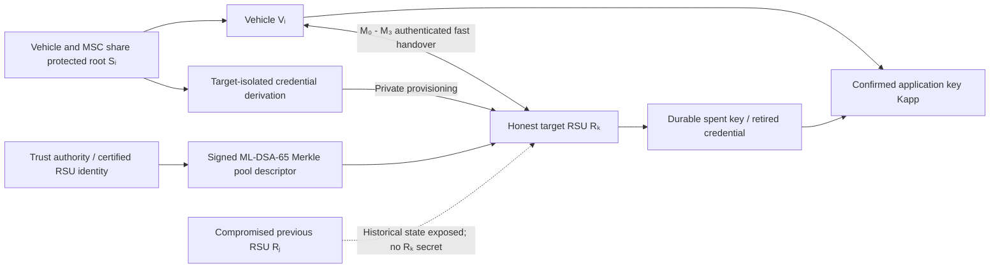

# MobiHeal: One-Hop Compromise Recovery for Post-Quantum Vehicular Handover

**MobiHeal: target-isolated, post-quantum authenticated handover with one-hop compromise recovery and durable single-use ML-KEM state for the Internet of Vehicles (IoV).**

> **Paper title:** *MobiHeal: One-Hop Compromise Recovery for Post-Quantum Vehicular Handover*  
> **Authors:** Anam Nasir, Md. Borhan, Arif Raza, Xiang He, and Zhongjie Wang  
> **Method:** MobiHeal — target-isolated mobility authenticators, signed Merkle key pools, and a four-message authenticated fast handover  
> **Evaluation:** native local-processing measurements, admission and concurrency tests, key-pool sensitivity, and controlled wireless-loss simulations  
> **Repository scope:** LaTeX manuscript, bibliography, reported figures, and archival research assets. **The supplied archive does not contain the executable cryptographic implementation or raw benchmark datasets.**

MobiHeal addresses a specific mobility-security problem: a roadside unit (RSU) may be compromised *after* a vehicle leaves its coverage area, exposing historical credentials and messages. Rather than allowing the former RSU to authorize the next handover, MobiHeal uses **independently provisioned, target-bound vehicle credentials** and **fresh ML-KEM-768 session entropy**. Under the paper's defined honesty, freshness, and erasure assumptions, the first **completed handover to a qualifying uncompromised target RSU** is the proposed one-hop recovery point.

The design also addresses full-transcript cryptographic privacy and the operational risks of ephemeral-key reuse. A **signed ML-DSA-65 Merkle pool** authenticates one-time RSU ML-KEM public keys without a per-handover online signature; authenticated admission and offer checks precede expensive KEM work; and irreversible, durable key-state transitions handle retransmission and restart.

**Evidence boundary:** the paper reports measurements for an *original* four-message fast-path implementation. The later **request-bound authenticated-offer** revision introduces a 16-byte `β₁` tag and specifies a controller-assisted fallback. Its modified processing latency and complete slow-path performance have **not** been separately measured in the supplied material. The repository is a **research manuscript/source archive**, not a runnable production V2X protocol stack.

---

## Methodology

The MobiHeal model contains a **vehicle** `Vᵢ`, a **mobility security controller** (MSC), a **trust authority** (TA), previously visited RSUs, and a prospective target RSU `Rₖ`. The former RSUs may be fully exposed; the new target must have its own independently provisioned credential and unexposed ephemeral decapsulation key for the recovery claim.



The online fast path assumes a **prevalidated, unexpired pool descriptor** and an already provisioned target-specific verifier record; these are not magically delivered by the four wireless messages.

### 1. Target-isolated one-hop healing (N1)

For target identifier `rₖ`, time window `w`, private vehicle counter `c`, and attempt index `a`, the vehicle and MSC derive distinct authenticator and pseudonym values:

\[
C_{k,w,c,a}=\operatorname{enc}(r_k,w,c,a),
\]

\[
A_a=\operatorname{KMAC}_{S_i}(C_{k,w,c,a};256,d_A), \qquad
P_a=\operatorname{Trunc}_{128}\!\left(\operatorname{KMAC}_{S_i}(C_{k,w,c,a};256,d_P)\right).
\]

The MSC sends the `(Pₐ, Aₐ)` verifier group **only to its intended target** over a protected infrastructure channel, together with an opaque record handle `g`. The hidden counter and MSC identity mapping are not transmitted over the wireless fast path. Different targets derive separate KMAC outputs, so disclosure of an old RSU's target records is not sufficient to authenticate at an independent new RSU under the stated PRF assumption.

**One-hop healing is conditional:** a replay, an incomplete exchange, a compromised new target, or disclosure of the vehicle/MSC root before the challenged session is **not** a qualifying recovery event.

### 2. Post-quantum authentication and transcript privacy (N2)

- **ML-KEM-768 (FIPS 203):** fresh, independently generated ephemeral RSU key pairs support post-quantum shared-secret establishment.
- **ML-DSA-65 (FIPS 204):** signs a Merkle pool descriptor offline. Each offered public key is authenticated by its ordered Merkle inclusion proof and verified certificate/epoch information.
- **SHA3-384 and KMAC256:** provide canonical transcript hashing and domain-separated credential, admission, confirmation, and application-key derivations.
- **Two-source key material:** the protocol combines an authenticator-derived PRF output and a KEM-secret-derived PRF output through an XOR combiner; application and confirmation keys use disjoint labels.
- **Matched-context privacy experiment:** challenge transcripts must be compared under matched public target, epoch, window, schedule, and timing class; vehicle-root and target-record leakage that trivially breaks the challenge is disallowed.

The manuscript distinguishes **credential-isolation and honest-run correctness arguments** from stronger computational **multi-session authenticated key exchange (AKE)** and **full-transcript unlinkability** claims, for which completed reductions and independent formal-model checks are still required.

### 3. Durable authenticated fast handover (N3)

| Message | Direction | Main fields | Mandatory verification / safety rule |
|---|---|---|---|
| `M₀` | Vehicle → target RSU | `Pₐ, w, N₀, α₀` | Validate target-bound admission tag `α₀` **before** reserving a KEM index. |
| `M₁` | Target RSU → vehicle | `rₖ, e, w, j, Nᴿ, pⱼ, πⱼ, β₁` | Durably reserve index `j`; validate the **request-bound** `β₁`, then the Merkle proof and descriptor. |
| `M₂` | Vehicle → target RSU | `Pₐ, Nⱽ, ct, α₂, τⱽ` | Check active offer and `α₂` **before** ML-KEM decapsulation; then verify vehicle confirmation. |
| `M₃` | Target RSU → vehicle | `sid, τᴿ` | Commit completion and `spent` state; erase the decapsulation secret; vehicle verifies `τᴿ` before advancing counter. |

1. **Provision:** MSC and vehicle derive a target-specific verifier group; the target prepares an independently generated ML-KEM pool with a signed Merkle root.
2. **Admit:** the vehicle sends `M₀`; an invalid `α₀` cannot reserve an ephemeral key.
3. **Offer:** the RSU commits `(offered, reserved)` to durable storage and sends `M₁` with the request-bound `β₁`. An exact `M₀` retransmission returns the cached, identical `M₁`.
4. **Establish:** the vehicle validates the offer and Merkle path, encapsulates to `pⱼ`, derives the session material, and sends `M₂`.
5. **Confirm:** the RSU verifies `α₂` before decapsulation and `τⱽ` after derivation. It commits `(completed, spent)`, erases the used decapsulation key, caches `M₃`, and sends the confirmation.
6. **Finalize:** the vehicle validates `τᴿ`, accepts the application key, and advances its hidden counter. Retried `M₂` retrieves cached `M₃` rather than triggering another decapsulation.
7. **Recover if unresolved:** bounded timeouts freeze the counter and use the paper's **MSC-assisted `B₀`–`B₃` slow path**, instead of reopening offered or spent resources.

### State and crash-consistency invariant

```text
RSU ephemeral index:   free ──durable offer──> reserved ──completion──> spent
                                                └──expiry/error──> abandoned

Vehicle record group:  unused ──offer──> offered ──confirmation──> completed
                                         └──timeout──────────────> expired

Forbidden: spent → free; abandoned → free; expired/offered key reissue.
```

A key that has been offered must **never** return to `free`, even if `M₁`, `M₂`, or `M₃` is lost or the RSU restarts. This property assumes atomic durable commits and effective secret deletion: source-code state transitions alone cannot prove crash or storage-rollback safety.

### Core design principles

- **Target isolation:** previous RSUs never receive the authenticator needed by a distinct target RSU.
- **One-hop recovery with explicit freshness:** recovery is evaluated at the first authenticated, completed, honest-target transition, not at mere movement into a new cell.
- **Post-quantum session entropy:** independent ephemeral ML-KEM contributes fresh secret material even if historical symmetric state is later exposed, subject to erasure/freshness assumptions.
- **Request-bound key offers:** an authenticated `β₁` ties `M₁` to the active `M₀` and prevents substitution of an unrelated signed-pool offer.
- **Admission before allocation/decapsulation:** reject malformed or unauthorized traffic before consuming scarce cryptographic resources.
- **Fail-closed persistent state:** cache exact retransmission responses and irreversibly retire previously offered indices.
- **Evidence-separated accounting:** label measured baseline costs, analytically derived revised payloads, and not-yet-benchmarked extensions separately.

---

## Repository structure

The tree below describes the **MobiHeal manuscript-source archive supplied with this project**, with this README and PNG previews added for GitHub viewing. It is **not** the unrelated mobile-healthcare demonstration repository.

```text
MobiHeal-research-main/
├── README.md                         # This research README
├── main.tex                          # Current MobiHeal manuscript and evaluation tables
├── references.bib                    # BibTeX bibliography
├── graphs/
│   ├── fig_handover_stage_latency.pdf    # Original manuscript plot
│   ├── fig_message_size_breakdown.pdf   # Original manuscript plot
│   ├── fig_loss_success_rate.pdf         # Original manuscript plot
│   ├── fig_loss_p95_latency.pdf          # Original manuscript plot
│   ├── fig_handover_stage_latency.png    # README preview of the matching PDF
│   ├── fig_message_size_breakdown.png    # README preview of the matching PDF
│   ├── fig_loss_success_rate.png         # README preview of the matching PDF
│   └── fig_loss_p95_latency.png          # README preview of the matching PDF
└── backup/
    ├── main.tex                      # Archived draft
    ├── new.tex                       # Archived alternate draft
    ├── references.bib                # Archived bibliography
    ├── graphs/                       # Additional archived experiment plots
    │   ├── fig_concurrency_throughput.pdf
    │   ├── fig_concurrency_p95_latency.pdf
    │   ├── fig_admission_flood_gating.pdf
    │   ├── fig_pool_amortization.pdf
    │   ├── fig_pool_storage.pdf
    │   └── ...
    ├── model/
    │   ├── MobiHeal_Methodology.pdf  # Archived design figure (may predate revisions)
    │   └── System model-R123.png     # Separate archived illustration
    └── zt_ptba_tifs_results/         # Historical, separate-topic figures and tables
```

**Archive audit:** the supplied ZIP includes `.tex`, `.bib`, graphics, and archival material. It **does not** include protocol source code, a public CLI, compiled native test binaries, raw run logs, per-seed CSV datasets, or an executable Tamarin/ProVerif model. Those are not inferred or invented in this README.

---

## Source tour

### `main.tex` — MobiHeal protocol and evaluation manuscript

This is the authoritative source for the supplied paper version. It contains:

- **Introduction and related work:** past-RSU exposure, transcript tracking, and durable post-quantum state requirements.
- **Section 3.1 — Preliminaries:** vehicle/RSU/MSC/TA roles, trust boundaries, canonical encoding, cryptographic suites, signed descriptors, and the corruption interface.
- **Section 3.2 — Problem formulation:** conditional one-hop recovery, matched-context unlinkability, one-time resource safety, and deployment costs.
- **Section 3.3 — One-hop mobility healing:** target-bound `Aₐ` and pseudonym `Pₐ`, opaque MSC handle, and the first qualifying healing transition.
- **Section 3.4 — Joint security model:** `Send`, `Reveal`, `CorruptRSU`, `RevealEph`, `CorruptVehicle`, `CorruptMSC`, and `Crash` queries; key/freshness experiments; target isolation and retired-session erasure assumptions.
- **Section 3.5 — Durable PQ handover:** `M₀`–`M₃`, the request-bound `β₁` revision, write-before-send state transitions, exact-reply caching, and MSC recovery `B₀`–`B₃`.
- **Section 4 — Evaluation:** native baseline processing, invalid-admission gates, completed-session concurrency, independent packet-loss simulations, pool storage, payload sizes, and limits of the evidence.
- **Section 5 — Conclusion:** the combined security boundary and unverified extensions.

### `references.bib` — cited literature and standards

BibTeX references used by `main.tex`, including FIPS 203 (ML-KEM), FIPS 204 (ML-DSA), FIPS 202/SHA-3, KMAC, V2X handover security, and post-compromise healing. The manuscript uses `IEEEtran` bibliography formatting.

### `graphs/` — manuscript figures

The four **root-level PDF plots** are included by `main.tex` and are the primary figure sources. Matching PNGs in this packaged version are **visual exports**, not additional experimental runs or new measurements.

### `backup/` — historical material

Earlier `.tex` versions, auxiliary plots, draft model figures, and separate legacy experiment assets. **Do not treat every archived plot as a current MobiHeal result**; follow the references in root `main.tex` for the active manuscript figures.

---

## Installation

### Requirements for rebuilding the manuscript

- A LaTeX distribution with **`pdflatex`**, **IEEEtran**, `amsmath`, `amsthm`, `algorithm`, `algorithmic`, `graphicx`, `tikz`, `subfig`, `booktabs`, `hyperref`, and the other packages imported at the top of `main.tex`.
- **BibTeX** (`bibtex` or `bibtex8`) and the `IEEEtran.bst` bibliography style.
- **`latexmk`** (recommended but optional) for a repeatable multi-pass build.
- Optional: **Poppler `pdftoppm`** to regenerate the GitHub-friendly PNG figure previews.

On Ubuntu/Debian, install an appropriately complete TeX Live bundle (package names vary by distribution). This manuscript does **not** require Python, CARLA, PyTorch, or network simulators simply to build the PDF.

---

## Quick start

Run commands from the repository root, where `main.tex`, `references.bib`, and `graphs/` reside.

### 1. Build the paper with `latexmk`

```bash
latexmk -pdf -interaction=nonstopmode -halt-on-error main.tex
```

This produces `main.pdf`. If `latexmk` cannot find your BibTeX executable, use the explicit sequence:

```bash
pdflatex -interaction=nonstopmode -halt-on-error main.tex
bibtex main          # or: bibtex8 main
pdflatex -interaction=nonstopmode -halt-on-error main.tex
pdflatex -interaction=nonstopmode -halt-on-error main.tex
```

The manuscript was successfully rebuilt from the supplied `.tex`, `.bib`, and graph sources using `pdflatex` and `bibtex8`. A minimal environment without the `bibtex` command may require the documented `bibtex8` fallback.

### 2. Inspect the protocol

Read the source in this order: `main.tex` Sections **3.1–3.2** (trust/freshness assumptions), **3.3** (target-isolated recovery), **3.4** (key and privacy games), **3.5** (complete `M₀`–`M₃` state machine), then **4** (what was actually measured).

### 3. Inspect reported result graphs

Open the PNG previews below or follow their matching `.pdf` sources. They correspond to the paper's existing figures; no benchmark rerun is triggered by displaying them.

### 4. Optional: regenerate PNG previews

```bash
pdftoppm -f 1 -l 1 -r 150 -png -singlefile \
  graphs/fig_handover_stage_latency.pdf graphs/fig_handover_stage_latency
pdftoppm -f 1 -l 1 -r 150 -png -singlefile \
  graphs/fig_message_size_breakdown.pdf graphs/fig_message_size_breakdown
pdftoppm -f 1 -l 1 -r 150 -png -singlefile \
  graphs/fig_loss_success_rate.pdf graphs/fig_loss_success_rate
pdftoppm -f 1 -l 1 -r 150 -png -singlefile \
  graphs/fig_loss_p95_latency.pdf graphs/fig_loss_p95_latency
```

### 5. Protocol implementation and benchmark reruns

**Not available in the supplied source archive.** There is no justified `python run.py`, `make benchmark`, simulator entry point, or security-proof command to provide. Reproducing native latency and traffic figures requires releasing the implementation, the selected crypto/storage backends, workload scripts, exact hardware metadata, and raw samples. The numbers below are **as reported in the manuscript**, not independently rerun here.

---

## Result graphs

### Native baseline handover processing — paper Fig. 2


[Open source plot (PDF)](graphs/fig_handover_stage_latency.pdf)

The native **original fast path** reports `6.982 ms` combined mean local processing, comprising `0.910 ms` vehicle work and `6.073 ms` RSU work (independently rounded values). These are local processing costs, **not wireless handover latency**. Both RSU stages include durable storage operations.

### Controlled packet-loss completion — paper Fig. 3


[Open source plot (PDF)](graphs/fig_loss_success_rate.pdf)

The controlled independent-loss simulation reports **99.74%** average completion at `10%` packet loss and **96.63%** at `20%` packet loss across its modeled network/mobility settings; this is not a field-network availability guarantee.

### Handover delay under packet loss — paper Fig. 4


[Open source plot (PDF)](graphs/fig_loss_p95_latency.pdf)

The manuscript reports a mean completion delay of `96.21 ms` and average p95 of `196.88 ms` at `20%` loss for the studied simulation grid. The figure shows sensitivity to one-way link delay; these delays cannot be inferred from the `6.982 ms` local processing mean alone.

### Merkle-pool message-size sensitivity — paper Fig. 5


[Open source plot (PDF)](graphs/fig_message_size_breakdown.pdf)

Increasing pool size `B` grows the Merkle authentication path in `M₁` logarithmically while increasing private-key storage approximately linearly. At `B = 1024`, the reported **original** `M₀`–`M₃` exchange is `3,048 bytes`; adding the **specified, not re-benchmarked** 128-bit `β₁` changes the calculated revised total to **3,064 bytes**, excluding descriptor acquisition and link-layer overhead.

---

## Result tables

The tables in this section transcribe the **reported manuscript values**. They are **not independently reproduced from raw samples** in this repository.

### Native local processing — original fast path (paper Table 8)

| Stage | Mean (ms) | p95 (ms) |
|---|---:|---:|
| Vehicle: prepare `M₀` | 0.148 | 0.201 |
| RSU: `M₀` → `M₁` | 2.830 | 3.780 |
| Vehicle: `M₁` → `M₂` | 0.640 | 0.780 |
| RSU: `M₂` → `M₃` | 3.243 | 4.342 |
| Vehicle: verify `M₃` | 0.122 | 0.174 |
| **Vehicle total** | **0.910** | **1.098** |
| **RSU total** | **6.073** | **7.737** |
| **Combined local processing** | **6.982** | **8.701** |

The table combines stage distributions; p95 values are **not additive**. The paper also reports a 95% interval of `[6.668, 7.296] ms` for the combined baseline mean across experimental seed means. The exact original hardware and library build are not supplied with the released archive.

### Selected baseline cryptographic and durable-store costs (paper Table 9)

| Operation | Mean time (ms) |
|---|---:|
| ML-KEM-768 encapsulation | 0.101 |
| ML-KEM-768 decapsulation | 0.134 |
| KMAC256, 32-byte output | 0.025 |
| Depth-10 Merkle-path verification | 0.016 |
| Offline ML-DSA-65 signature | 11.660 |
| Offer durable commit | 2.745 |
| Completion durable commit | 2.693 |

The two durable commits together account for about **89.5%** of the reported `6.073 ms` RSU local-processing mean. Offline ML-DSA signing is **not** in the four-message online critical path.

### Baseline admission-gate rejection (paper Table 11)

| Invalid traffic class | Requests/s | Mean rejection cost (µs) |
|---|---:|---:|
| Unknown pseudonym in `M₀` | 1,245,742 | 0.82 |
| Known pseudonym; invalid `α₀` | 38,342 | 26.23 |
| Invalid `α₂` | 18,299 | 56.03 |

The manuscript reports **zero unauthorized KEM reservations and zero unauthorized decapsulations** for these measured invalid-request classes. This is not a DoS-resistance guarantee against unlimited packets, authorized malicious clients, or radio jamming.

### Completed-session concurrency scaling (paper Table 12)

| Outstanding sessions | Completed/s | Mean latency (ms) | p95 latency (ms) |
|---|---:|---:|---:|
| 1 | 110.5 | 9.0 | 14.3 |
| 8 | 105.2 | 75.0 | 124.3 |
| 32 | 103.2 | 291.2 | 458.1 |
| 64 | 107.5 | 517.1 | 725.3 |
| 128 | 109.4 | 857.4 | 1,082.4 |

Throughput remains near the reported single-host capacity, while queueing delay rises sharply with concurrent requests. No multi-RSU or multi-host scaling speedup is established.

### ML-KEM key-pool cost and V2I payload (paper Tables 13–14)

| Pool size `B` | Offline preparation (ms) | Pool storage (MiB) | Original `M₀`–`M₃` bytes | Revised bytes with `β₁` |
|---:|---:|---:|---:|---:|
| 64 | 16.332 | 0.225 | 2,856 | 2,872 |
| 256 | 30.126 | 0.890 | 2,952 | 2,968 |
| **1,024** | **87.308** | **3.551** | **3,048** | **3,064** |
| 4,096 | Not reported | 14.195 | 3,144 | 3,160 |

Revised byte totals are **arithmetic additions of 16 bytes**, not fresh transport measurements. At `B = 1024`, the original four message sizes are `M₀ = 72 B`, `M₁ = 1,712 B`, `M₂ = 1,184 B`, `M₃ = 80 B`. The revision changes `M₁` to `1,728 B`. A cached signed descriptor, certificates, radio/link headers, retransmissions, and packet fragmentation are **not** included in this warm-cache count.

---

## Metrics and interpretation

| Metric or term | Interpretation and scope |
|---|---|
| **Healing distance `d_heal`** | Completed honest-target transitions following historical RSU corruption until the first qualifying recovered session; the paper's objective is **one**, conditionally. |
| **One-hop key/authentication recovery** | AKE security under specified past-RSU exposure and **continued challenge freshness**; not a demonstration that any RSU change automatically heals compromise. |
| **Transcript unlinkability** | Advantage in a matched-public-context, two-vehicle transcript distinguishing experiment; excludes physical tracking and forbidden root/target-record disclosures. |
| **Retired-session secrecy** | Secrecy after later root/MSC exposure, assuming correct past KEM private-key erasure and completed application-key deletion. |
| **One-time index safety** | Offered ML-KEM index is never released to `free` again across loss, timeout, duplication, and restart under atomic durable storage assumptions. |
| **Combined local processing** | Sum of the vehicle and RSU **CPU/crypto/persistence** work of the measured original fast path; excludes wireless, queueing, and controller operations. |
| **Warm-cache V2I bytes** | Application-level `M₀`–`M₃` payload accounting with descriptor already cached; revised payload increases by 16 bytes. |
| **Admission throughput** | Rate at which specific invalid request classes are rejected under the reported local test arrangement. |
| **Completed-session throughput** | Successful fast-path handshakes per second on the reported single-host concurrency experiment. |
| **Packet-loss completion rate** | Success fraction in the controlled independent-loss network/mobility simulation, not real-road availability. |
| **p95 completion latency** | 95th percentile of completion-time samples in the indicated experiment; includes modeling/queueing choices specific to that experiment. |

---

## Threat model and security limitations

MobiHeal's confidentiality and authentication goals are **conditional** on a trusted TA and MSC, a protected provisioning channel, a protected vehicle root until the challenged handover completes, a fresh independently provisioned target verifier record, valid signed pool metadata, an uncompromised target for the challenged session, and correct lifecycle management of ephemeral private keys. The adversary may control wireless packets and compromise **previously visited** RSUs, including their local signing, verifier, session, and cached state.

The manuscript's stated security treatment **does not** provide unconditional recovery from compromise of the new target, the live vehicle root/MSC, challenge session keys, a broken random-number source, storage rollback, or a compromised provisioning channel. Cryptographic transcript privacy does not cover physical location, timing metadata outside the matched experiment, radio fingerprinting, application-layer identity, denial of service, or jamming.

The **honest-run agreement** and **one-time state invariant** are articulated subject to their explicit assumptions. Complete computational AKE/unlinkability reductions, an executable Tamarin/ProVerif artifact, revised `β₁` implementation measurements, and a fully measured MSC slow path are **not** included in the supplied material. No deployment certification or real-world safety guarantee should be inferred.

---

## Reproducibility notes

- **Baseline configuration:** ML-KEM-768, ML-DSA-65, SHA3-384, KMAC256, and a signed ephemeral Merkle pool with nominal `B = 1024`.
- **Measurement boundary:** `6.982 ms` is local processing for the **original** fast path, not end-to-end mobility latency. It excludes pool preparation, descriptor provisioning, radio exchange, queuing, and the MSC completion report.
- **Authenticated-offer revision:** `β₁` is a request-bound 128-bit KMAC tag in `M₁`; the revised `3,064 B` count at `B = 1024` is derived arithmetically, while revised latency requires new measurements.
- **Reported functional evidence:** the paper mentions **16 baseline implementation self-checks** and crash-state tests across **10 seeds**. The test harness and raw traces are **not** in the supplied archive.
- **Independent-loss experiment:** modeled loss `0–20%`, one-way delay `1–20 ms`, speed `30–120 km/h`, handover zone `10–50 m`, at most **four attempts per message stage**, and a `50 ms` retransmission timeout.
- **Prepositioning cost:** for `m` candidate RSUs and `q` attempt pseudonyms per target, provisioning uses `m × q` verifier pairs plus `m` opaque handles, apart from the warm-cache wireless accounting.
- **Pool capacity:** the paper suggests first-order sizing `B ≳ λₕ Tᵣ` when admitted arrival rate accounts for **completed and abandoned** offers; burstiness and controller outages require extra reserve capacity.
- **Hardware and scripts:** the exact native benchmark machine, storage medium, crypto library build, sample count, full raw data, and updated executable protocol are **not supplied**, so the numerical tables here are **reported results**, not independently reproduced measurements.
- **Required follow-up validation:** implement and benchmark the current `β₁` revision, test power loss at every persistence boundary, validate loss and resynchronization under realistic V2X traces, and release executable formal evidence for the stated attack models.


**Research use only.** Any implementation must independently validate the cryptography, persistence guarantees, trust provisioning, side-channel behavior, and deployment security assumptions.
