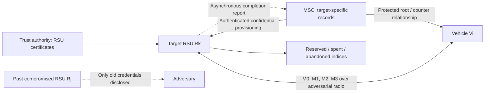

# MobiHeal: One-Hop Compromise Recovery for Post-Quantum Vehicular Handover

**Research documentation for target-isolated authentication, post-quantum session establishment, and failure-safe handover in the Internet of Vehicles (IoV).**

> **Research manuscript:** *MobiHeal: One-Hop Compromise Recovery for Post-Quantum Vehicular Handover*  
> **Authors:** Anam Nasir, Md. Borhan, Arif Raza, Xiang He, and Zhongjie Wang  
> **Security design:** independent credentials for each target RSU, ML-KEM-768 key establishment, ML-DSA-65-authenticated ephemeral-key pools, and crash-consistent handover  
> **Research artifacts:** manuscript source, bibliography, five manuscript figures (including the LaTeX system diagram), fourteen manuscript tables, PDF/PNG plots, and a separately supplied experimental notebook  
> **Evidence status:** reported manuscript measurements and simulations are differentiated from formula-based estimates, notebook outputs, and proposed—not yet fully evaluated—protocol extensions.

## Overview

Vehicles frequently leave one roadside unit (RSU) and connect to another. An RSU that has been compromised can expose authentication records, session data, and recorded wireless exchanges, and these artifacts may outlive the vehicle's association with that RSU. Merely replacing the network attachment point does not necessarily eliminate the consequences of that exposure.

MobiHeal studies a specific recovery boundary: **can the first *completed* handshake with a separately provisioned, uncompromised target RSU produce an authenticated, fresh application key even when previously visited RSUs have been disclosed?** Its answer is a **conditional design objective**, not a universal guarantee. The new target must have an independent vehicle authenticator, an uncompromised ephemeral ML-KEM secret, and valid trust metadata; the vehicle/controller root must remain protected through the challenged session.

Three engineering decisions support this objective:

1. **Isolate authorization by destination.** Each candidate RSU receives its own pseudonym/authenticator group over a protected controller channel. A former RSU never receives the group assigned to a different target.
2. **Mix freshly established post-quantum secret material into the session key.** A target offers one of its independently generated ML-KEM-768 public keys from a signed Merkle pool. The vehicle authenticates both the pool and the specific offer before encapsulation.
3. **Treat key use as irreversible state.** Verified requests lead to durable reservations; completed or abandoned keys cannot be placed back into the free pool after a retransmission, timeout, or restart.

The research distinguishes a **measured original four-message implementation** from a **revised protocol specification** that adds a request-bound `β₁` tag to the RSU offer and includes an MSC-assisted recovery exchange. These revisions need their own timing and end-to-end security evaluation; numerical performance claims below are identified by evidence type.

### At a glance

| Aspect | MobiHeal design | Important condition |
|---|---|---|
| Recovery target | First qualifying honest-target completed handover (`d_heal = 1`) | Not a recovery claim for a compromised target or vehicle root |
| New key contribution | Independently generated **ML-KEM-768** ephemeral secret | Matching secret/key erasure and AKE freshness required |
| RSU key authentication | **ML-DSA-65** signed Merkle descriptor and per-index proof | Certificate, signature, expiry, epoch, and revocation must be checked |
| Vehicle admission | Target-bound KMAC authenticator | Secret is distributed only to the selected target |
| Fast exchange | Four messages, `M₀`–`M₃` | Prepositioning and descriptor validation happen beforehand |
| Loss tolerance | Exact response caching and irreversible key states | Progress is not assured against indefinite network suppression |
| Original local processing | **6.982 ms** reported mean | Excludes radio delay, queueing, provisioning, and slow-path traffic |
| Original warm-cache payload (`B=1024`) | **3,048 bytes** | Excludes cached descriptor, link headers, and retransmission overhead |
| Revised warm-cache payload (`B=1024`) | **3,064 bytes**, calculated | Adds 16-byte `β₁`; revised processing latency is **unmeasured** |

---

## Contents

- [Methodology and trust architecture](#methodology-and-trust-architecture)
- [Protocol walkthrough](#protocol-walkthrough)
- [Security experiments and assumptions](#security-experiments-and-assumptions)
- [Repository structure and code tour](#repository-structure-and-code-tour)
- [Requirements and installation](#requirements-and-installation)
- [Quick start and reproducibility notebook](#quick-start-and-reproducibility-notebook)
- [Figures and graphs: descriptions and interpretation](#figures-and-graphs-descriptions-and-interpretation)
- [Results tables: values and analysis](#results-tables-values-and-analysis)
- [Metrics and result interpretation](#metrics-and-result-interpretation)
- [Limitations, validation gaps, and future experiments](#limitations-validation-gaps-and-future-experiments)
- [Research attribution and use](#research-attribution-and-use)

---

## Methodology and trust architecture

### Participants and trust boundaries

MobiHeal separates the wireless authentication exchange from the distribution of private authorization records:

| Participant | Responsibility | Information that matters to security |
|---|---|---|
| Vehicle `Vᵢ` | Maintains a protected root `Sᵢ`, local counter, and pending handover state; authenticates offers and confirms keys | Root disclosure before a challenge invalidates the intended recovery and privacy experiments |
| Previous RSU `Rⱼ` | Former serving infrastructure node; may be compromised | Attacker may learn its complete local state but should not thereby learn the next target's authenticator |
| Target RSU `Rₖ` | Verifies target-bound credentials and offers independently generated ephemeral ML-KEM keys | Must remain honest for the challenged exchange and protect its decapsulation secret until erasure |
| Mobility Security Controller (MSC) | Derives/provisions target-specific records and reconciles unresolved counters | Trusted during fast-path preparation and controller-assisted recovery |
| Trust authority (TA) | Anchors the RSU signing-key certification chain | Certificate validation, revocation, and anti-rollback are prerequisites |

**Figure 1 — Fast-path trust boundary (source: TikZ drawing in `main.tex`, `fig:architecture`).** The figure puts the vehicle and target RSU on the online `M₀`–`M₃` channel, with a provisioning arrow from the MSC to the target. The already compromised RSU appears outside this trust boundary: its disclosure reveals historical data, not the independently provisioned verifier secret at the new target. The figure illustrates which party holds which authority; **it does not itself establish confidentiality of the infrastructure channel or quantify network latency.**



*The Mermaid diagram above is an original README schematic explaining the manuscript's trust relationships; it is not a reproduced experimental result.*

### N1 — Target-isolated mobility credentials

For each candidate target identifier `rₖ`, authorization window `w`, private counter `c`, and allowable retry index `a`, the vehicle and MSC calculate distinct values from the protected vehicle root `Sᵢ`:

$$
C_{k,w,c,a}=\operatorname{enc}(r_k,w,c,a)
$$

$$
A_a=\operatorname{KMAC}_{S_i}(C_{k,w,c,a};256,d_A),\qquad
P_a=\operatorname{Trunc}_{128}\!\left(\operatorname{KMAC}_{S_i}(C_{k,w,c,a};256,d_P)\right).
$$

`Aₐ` authenticates requests, while `Pₐ` acts as the on-air pseudonym. The KMAC labels differ, so the two values play separate roles; the target identifier in the encoded input prevents an old target's derived output from being a valid new-target credential under the assumed pseudorandom-function security.

The controller generates an unpredictable record handle `g` and privately maps it to the corresponding vehicle, counter, target, and window. The target receives its bounded `(Pₐ, Aₐ)` group and the handle; it does **not** receive the readable vehicle counter or a reusable credential for other RSUs. A completed handover invalidates the rest of the group's alternatives. Repeated transmission of an *identical packet* remains linkable at packet level, which is not inconsistent with the more narrowly defined cryptographic privacy experiment.

### N2 — Post-quantum key establishment and privacy model

For epoch `e`, the target prepares `B` independently generated ML-KEM-768 key pairs `(pⱼ, sⱼ)`. A Merkle leaf binds each public key to its target, epoch, and index. One ML-DSA-65 signature certifies the pool descriptor, including the Merkle root. During the fast exchange the RSU transmits the selected public key and its authentication path, **not a fresh full signature**.

The vehicle first validates the certified descriptor and the authenticated current offer. Once it encapsulates to `pⱼ`, both peers derive a post-quantum contribution `Z`. The key schedule mixes a PRF output derived from `Aₐ` with a PRF output derived from `Z` using disjoint domain labels and an XOR combiner:

$$
Y_A=\operatorname{KMAC}_{A_a}(h_2;256,d_{\mathrm{mixA}}),\qquad
Y_Z=\operatorname{KMAC}_{Z}(h_2;256,d_{\mathrm{mixZ}})
$$

$$
K^*=Y_A\oplus Y_Z,\qquad
K_{\mathrm{app}}=\operatorname{KMAC}_{K^*}(h;256,d_{\mathrm{app}}).
$$

`h₂` and `h` are transcript hashes constructed from canonically encoded messages. Confirmation keys are generated under **different** labels from the application key so a public confirmation tag is not simply a public guess-check function for the protected application key.

**Interpretation:** an attacker who has old RSU records cannot automatically reproduce `Aₐ` for an unrelated target. Later exposure of the vehicle's root also does not directly reveal an already retired KEM secret **if the relevant ephemeral private key and the completed application-key copies were effectively erased**. Turning this construction into a full adversarial, concurrent-session key-indistinguishability proof requires more than primitive security alone.

### N3 — Fail-closed state transitions

The target's ephemeral-key index progresses through the following states:

```text
free --(verified admission; durable offer)--> reserved
reserved --(verified completion; durable commit)--> spent
reserved --(expiry / authenticated failure)--> abandoned

NEVER: spent -> free
NEVER: abandoned -> free
NEVER: already offered index -> a distinct handover
```

The vehicle's one-time target record likewise progresses from `unused` to `offered`, then either `completed` or `expired`. A duplicated `M₀` or `M₂` can retrieve the original cached response but cannot create another key allocation or re-run a completed decapsulation. These are **conditional invariants**: atomic commit ordering, non-rollback storage, and deletion of ephemeral private keys must hold in the actual deployment, not just in an in-memory simulation.

---

## Protocol walkthrough

### The four-message fast path

| Message | Sender → receiver | Purpose and fields | Receiver gate |
|---|---|---|---|
| **`M₀`** | Vehicle → RSU | Present `(Pₐ, w, N₀, α₀)` as a target-bound admission attempt | Verify `α₀` before reserving a pool slot |
| **`M₁`** | RSU → vehicle | Offer `(rₖ, e, w, j, Nᴿ, pⱼ, πⱼ, β₁)` | Match `β₁` to the active `M₀`; validate descriptor and ordered Merkle proof |
| **`M₂`** | Vehicle → RSU | Send `(Pₐ, Nⱽ, ct, α₂, τⱽ)` after encapsulation and key derivation | Check active offer and `α₂` before decapsulation; verify `τⱽ` afterward |
| **`M₃`** | RSU → vehicle | Deliver `(sid, τᴿ)` after committing completion | Verify final authenticator; only then accept key and advance counter |

#### Step 1 — Preparation (not counted in warm-cache online timing)

The MSC prepositions the right verifier at each possible target over its private infrastructure channel. Separately, the RSU has already generated the ephemeral key pool, signed its root descriptor, and made the descriptor discoverable. The vehicle checks authenticity, expiration, revocation, and epoch monotonicity **before** trusting a proof from that pool.

#### Step 2 — Initial admission, `M₀`

The vehicle chooses a fresh request nonce and derives `α₀` from the target-specific authenticator and a hash of the request context. An unknown pseudonym or incorrect tag is rejected without touching the one-time key pool. This ordering matters under unsolicited traffic because a key pool is finite and individual ephemeral keys cannot safely be recycled once offered.

#### Step 3 — Authenticated ephemeral offer, `M₁`

After successful admission, the RSU chooses an unused index, records the exact request/offer and reservation in durable storage, and emits its signed-pool Merkle proof. The revision adds **`β₁`**, a 128-bit KMAC tag that commits the offer to the active request context. Verifying only a valid Merkle leaf is not enough: a previously legitimate leaf could otherwise be substituted from an unrelated earlier offer.

#### Step 4 — Post-quantum encapsulation, `M₂`

The vehicle rejects an offer whose tag or Merkle proof is inconsistent, then encapsulates to the authenticated ML-KEM public key. It derives independent application/confirmation secrets, sends a pre-decapsulation authenticator `α₂`, and proves possession of the combined secret using `τⱽ`. The RSU must verify `α₂` **before** invoking the costlier KEM decapsulation.

#### Step 5 — Durable finish, `M₃`

Following a valid `M₂`, the RSU commits the record to `completed`, marks the index `spent`, deletes the active decapsulation secret, retains a bounded response cache for exact retransmissions, and sends `M₃`. The vehicle only advances its hidden counter after authenticating the received confirmation. This avoids treating a sent—but unacknowledged—message as a completed handover.

### Lost-packet and restart behavior

| Condition | Required response | Why it matters |
|---|---|---|
| `M₀` unknown or incorrectly authenticated | Reject without key reservation | Unauthenticated traffic must not consume scarce indices |
| Repeated exact `M₀` | Return the previously committed `M₁` | Avoid changing the offer on radio retry |
| Stale, altered, or unverifiable `M₁` | Reject; do not encapsulate | Prevent an unrelated signed key from being treated as the current offer |
| Invalid `α₂` | Reject before decapsulation | Avoid avoidable KEM CPU expense |
| Repeated exact `M₂` after completion | Return cached `M₃` | Do not reuse or re-open a spent KEM key |
| Expired offer or restart | Reload committed state; abandon unresolved reserved indices where required | Keys exposed in an offer must not be advertised again |
| Unresolved end-to-end completion | Freeze counter and start authenticated MSC recovery | Avoid simultaneous counter divergence between vehicle and controller |

### Controller-assisted reconciliation (`B₀`–`B₃`)

If bounded retries cannot determine whether `M₃` was accepted, the vehicle uses a **separate authenticated controller path**, not another attempt with the same unresolved fast-path counter. The manuscript specifies a challenge/encapsulation exchange with the MSC, reconciliation of outstanding completion receipts, retirement of stale target records, and a protected counter update with newly prepared handles. This path depends on a reachable, uncompromised MSC and eventually cleared offers. **No independent latency or availability measurements for the complete slow path are supplied.**

---

## Security experiments and assumptions

The research is about *how a security claim is scoped*, not only whether two honest parties can produce the same key.

| Experiment | Attacker capabilities permitted | Exclusions needed for the stated claim | What a positive result would mean |
|---|---|---|---|
| One-hop post-compromise healing (OPMH) | Historical RSU corruption and active radio-message control | Challenged target/credential and challenge ephemeral secret must remain unexposed; root/MSC uncompromised through completion | Past RSU state does not suffice to impersonate the vehicle or distinguish the new accepted application key |
| Retired-session secrecy | Later vehicle-root/MSC information disclosure | Previously completed application keys and ephemeral decapsulation secret must have been erased | Later controller disclosure alone does not reconstruct an appropriately retired key |
| Matched-context transcript privacy | Exposure of past RSUs, active packet scheduling | Candidate roots, new target mapping, and challenge-distinguishing disclosures withheld | Cryptographic transcripts from eligible vehicles remain hard to link after public context is matched |
| Single-use index safety | Duplicate messages, timeouts, process restart | Atomic durable commits, rollback resistance, effective deletion | An index already offered does not become a fresh offer for another session |

**Outside scope:** physical tracking, radio fingerprints, deliberate jamming, compromise of the new target during the challenged session, pre-challenge MSC/root compromise, or unbounded network outage. Also, an adversary learning a key still resident at an endpoint cannot be expected to fail a game that tests that very key.

An **honest-run agreement statement** and a **durable-state invariant** are provided in the manuscript under their assumptions. Functional self-tests are valuable consistency checks, but they cannot replace a complete computational reduction for active AKE or an independently verified transcript-privacy equivalence model.

---

## Repository structure and code tour

The tree documents the **research-manuscript repository**, not the unrelated health-services demo that has also circulated under the name MobiHeal.

```text
MobiHeal-research-main/
├── README.md                              # This in-depth, original repository guide
├── main.tex                               # Current manuscript and embedded Figure 1 (TikZ)
├── references.bib                         # Research references and standard specifications
├── graphs/
│   ├── fig_handover_stage_latency.pdf     # Fig. 2 source
│   ├── fig_handover_stage_latency.png     # GitHub preview
│   ├── fig_loss_success_rate.pdf          # Fig. 3 source
│   ├── fig_loss_success_rate.png          # GitHub preview
│   ├── fig_loss_p95_latency.pdf           # Fig. 4 source
│   ├── fig_loss_p95_latency.png           # GitHub preview
│   ├── fig_message_size_breakdown.pdf     # Fig. 5 source
│   └── fig_message_size_breakdown.png     # GitHub preview
├── notebooks/
│   └── MobiHeal_Paper_Final.ipynb         # Separately supplied experimental companion notebook
└── backup/
    ├── main.tex / new.tex                # Older manuscript versions
    ├── references.bib                     # Historical reference list
    ├── graphs/                            # Older/unreferenced experimental graphics
    ├── model/                             # Archived design images (not current Fig. 1)
    └── zt_ptba_tifs_results/              # Different historical research assets
```

### Manuscript and bibliography

`main.tex` is the source of record for the five figures and fourteen numbered tables described in this README. It defines the threat model, credential derivation, handover messages, cryptographic assumptions, local benchmarks, packet-loss simulation setup, and open proof obligations. `references.bib` provides the manuscript's citations; it should be updated alongside any new related-work claim.

### Experimental notebook

`notebooks/MobiHeal_Paper_Final.ipynb` was supplied separately from the original manuscript archive and is included as a **companion artifact**, not retroactively claimed to be the source of the published-in-manuscript values. It contains:

- KMAC/SHA3 derivation checks, canonical encoding, Merkle authentication, and post-quantum backend adapters;
- a SQLite/WAL reference state machine, retransmission handling, and functional self-tests;
- local cryptographic and handover timing, pool accounting, admission-gate and concurrency experiments;
- independent-loss/delay/mobility simulation and failure-boundary diagnostics;
- generation of raw/summary CSVs, figures, environment metadata, checksums, and a `results.zip` bundle;
- disclosure of readiness limitations (including non-demonstrated physical secure erasure and unavailable Tamarin proofs).

The notebook contains **saved outputs from a previous execution**; saving an output is not the same as independently rerunning that result in this repository. The notebook explicitly documents a recovery-metadata refinement: the reference implementation retains the **exact public `M₀`** as well as its hash so an `M₂` retry can be processed after restart. This is an implementation-alignment note to be reconciled with the manuscript rather than silently presented as an unchanged paper protocol.

### Historical assets and provenance

Root `graphs/` plots are the current manuscript figures. `backup/` may contain older versions, separate-topic data, or figures that do **not** appear in the current paper. Their presence is not evidence that their numbers are valid for the present experimental configuration. In particular, the archived diagram under `backup/model/` is not automatically the current RSU/MSC architecture.

**What is not provided as a stand-alone artifact:** a production V2X deployment stack, a documented hardware testbed dataset, a self-contained formal Tamarin/ProVerif proof, or verified implementation measurements for the revised offer and MSC slow path. The notebook should be evaluated as its own reproducibility artifact rather than assuming these missing components exist.

---

## Requirements and installation

### A. Building the paper (minimal path)

Install a LaTeX distribution with `pdflatex`, `IEEEtran`, `amsmath`, `amsthm`, `algorithm`, `algorithmic`, `graphicx`, `tikz`, `subfig`, `booktabs`, `hyperref`, and a suitable BibTeX executable (`bibtex` or `bibtex8`). `latexmk` and Poppler are useful but optional.

From the repository root:

```bash
latexmk -pdf -interaction=nonstopmode -halt-on-error main.tex
```

Or use explicit passes:

```bash
pdflatex -interaction=nonstopmode -halt-on-error main.tex
bibtex main          # On systems without bibtex: bibtex8 main
pdflatex -interaction=nonstopmode -halt-on-error main.tex
pdflatex -interaction=nonstopmode -halt-on-error main.tex
```

The paper's PDF can be rebuilt **without** installing a cryptographic runtime. Root PDF graphs are embedded by LaTeX. Figures in `graphs/*.png` are preview copies intended for README rendering, not separate runs.

### B. Running the separately supplied notebook

A Python 3 Jupyter environment is needed. The notebook imports `numpy`, `pandas`, `matplotlib`, and optionally `psutil`; its **paper mode** requires a compatible `pqcrypto` implementation exposing **ML-KEM-768/ML-DSA-65** and **PyCryptodome** for optimized KMAC256. Compatibility depends on Python, platform, and library builds.

```bash
python -m venv .venv
source .venv/bin/activate       # Windows PowerShell: .venv\\Scripts\\Activate.ps1
python -m pip install --upgrade pip
python -m pip install jupyter nbconvert numpy pandas matplotlib psutil \
    'pqcrypto==1.0.0' 'pycryptodome==3.23.0'
```

If the `pqcrypto` version lacks a compatible binary wheel, use a supported platform/version and **record the substitution**. The notebook includes a documented fallback adapter for older library APIs; do not silently substitute an emulator and claim standard-library timing. Paper mode may run substantial multi-seed, cryptographic, and Monte Carlo work.

---

## Quick start and reproducibility notebook

### 1. View and build the current manuscript

```bash
pdflatex -interaction=nonstopmode -halt-on-error main.tex
bibtex8 main
pdflatex -interaction=nonstopmode -halt-on-error main.tex
pdflatex -interaction=nonstopmode -halt-on-error main.tex
```

`main.pdf` contains the rendered Figure 1 (the trust-boundary drawing) and the linked Figure 2–5 plots. Read the protocol model in Section 3 before interpreting the measurements in Section 4.

### 2. Review all four source result plots

Open `graphs/*.png` below or inspect their PDF originals. They are static recorded plots. **Viewing a graph does not regenerate or validate the underlying samples.**

### 3. Open the notebook

```bash
jupyter lab notebooks/MobiHeal_Paper_Final.ipynb
```

The notebook defaults to paper mode and may attempt dependency installation. To prevent automatic installation on managed machines, set `MOBIHEAL_AUTO_INSTALL=0`. The following command runs a **development-only** smoke configuration; its emulator-backed performance values, if used, must never be reported as post-quantum native measurements:

```bash
MOBIHEAL_AUTO_INSTALL=0 MOBIHEAL_PAPER_MODE=0 \
  jupyter nbconvert --to notebook --execute notebooks/MobiHeal_Paper_Final.ipynb \
  --output MobiHeal_Paper_Final.dev-executed.ipynb
```

To obtain new paper-mode measurements, use a properly installed native PQ backend and an isolated working directory:

```bash
MOBIHEAL_AUTO_INSTALL=0 MOBIHEAL_PAPER_MODE=1 \
MOBIHEAL_PLATFORM_LABEL=lab-workstation-01 \
  jupyter nbconvert --to notebook --execute notebooks/MobiHeal_Paper_Final.ipynb \
  --output MobiHeal_Paper_Final.executed.ipynb
```

**Caution:** the notebook writes `results/` relative to its working directory and, by default, clears that directory before export (`MOBIHEAL_CLEAN_RESULTS=1`). Run from a clean scratch checkout, or set `MOBIHEAL_CLEAN_RESULTS=0` if existing outputs must not be deleted. Notebook execution has **not** been independently validated as part of this README update.

### 4. Understand notebook outputs versus manuscript tables

A successful notebook execution is designed to create CSVs such as `handover_raw.csv`, `handover_summary.csv`, `primitive_summary.csv`, `message_sizes.csv`, `concurrency_summary.csv`, `admission_flood_summary.csv`, `network_summary.csv`, and `publication_readiness.csv`, together with a manifest, figures, and `results.zip`.

Treat these as **new, platform-labeled results**. They do not automatically reproduce manuscript Table 8 or its confidence intervals: those originally reported measurements have incomplete hardware/build provenance in the available paper source. Compare results only when crypto backend, persistence settings, pool size, warm-up design, and latency boundaries agree.

---

## Figures and graphs: descriptions and interpretation

This section covers **every figure in the current manuscript**. Each entry describes the plot, the result it can substantiate, what it cannot substantiate, and where to find its source. The language is explanatory and newly written; the reported values are attributed to the supplied research manuscript.

### Figure 1 — Security architecture and handover trust boundary

**Where:** built from the `tikzpicture` in `main.tex` (`fig:architecture`); visible in the compiled manuscript. The original figure is **not** an external file in root `graphs/`.

**What it depicts:** a vehicle exchanges four wireless messages with a target RSU; the MSC has a separate route to deliver target-specific authorization material; the previous RSU is drawn as compromised and restricted to its previously held state. The signed key-pool certificate comes from the RSU/TA trust relationship and must be checked separately.

**Why it matters:** the single-hop recovery claim depends on *who possessed the credential before handover*. It would fail if a compromised source could simply generate the credential that the new target accepts. Independent target provisioning changes this causal relationship.

**Limits:** the picture is an architecture model, **not** a measured healing success-rate chart. It does not show real RSU geometry, road mobility traces, PHY security, or the cost of the prior provisioning connection.

### Figure 2 — Original fast-path processing by stage


[Original figure PDF](graphs/fig_handover_stage_latency.pdf)

**Axes:** individual online stages along the vertical axis, with mean **local processing time in milliseconds** on the horizontal axis. Error bars describe reported variability/intervals over experimental seed means. The chart divides work between vehicle and RSU rather than collapsing it into one handshake number.

**What stands out:** the RSU's `M₀ → M₁` and `M₂ → M₃` steps take approximately `2.830 ms` and `3.243 ms`, respectively. Vehicle-side stages are materially shorter (`0.148`, `0.640`, and `0.122 ms`), so the combined baseline local mean is `6.982 ms`. The RSU's two durable commits are a plausible major contributor to its larger share, and the manuscript separately reports their cost.

**Interpretation:** optimizing KEM arithmetic alone is unlikely to remove the storage-related floor in the stated implementation. This is useful for choosing what to profile next: durable write latency, transaction grouping, I/O scheduling, and end-to-end latency under contention.

**Do not conclude:** this is not the time to cross the radio interface, not the elapsed time during a moving vehicle's full handover, and **not a measurement of the revised `β₁` offer**. Its p95 summary is a separately reported distribution metric and cannot be calculated by summing five stage p95 values.

### Figure 3 — Completion success against independent packet loss


[Original figure PDF](graphs/fig_loss_success_rate.pdf)

**Axes:** independently assigned packet-loss probability (horizontal, %) and proportion of successfully completed simulated handovers (vertical, %). The curve uses a controlled network/mobility model with bounded retries and a preloaded local processing profile.

**What stands out:** the low-loss portion is near 100%; the reported aggregate success rate is `99.74%` at `10%` independent loss, falling to `96.63%` at `20%`. This is a smooth deterioration in a model where each packet's erasure is independently sampled; packet loss and vehicle dwell time jointly reduce opportunities for retry.

**Interpretation:** idempotent cached replies and bounded retransmissions can preserve a high *modeled* completion rate in the parameter grid, but the remaining failures matter for counter reconciliation and available pool capacity.

**Do not conclude:** the curve is **not measured on an 802.11p/C-V2X radio**, and independent packet loss cannot represent correlated fades, hidden terminals, congestion bursts, targeted jamming, or complete controller outage. The plotted completion rate is not a proof of crash safety or key secrecy.

### Figure 4 — 95th-percentile handover delay under loss


[Original figure PDF](graphs/fig_loss_p95_latency.pdf)

**Axes:** packet-loss probability (horizontal, %) and simulated **p95 completion latency in milliseconds** (vertical). Separate curves represent one-way link delays of `1`, `5`, `10`, and `20 ms`, allowing radio delay and retransmission effects to be interpreted separately.

**What stands out:** at `20%` independent packet loss, the reported p95 is about `164.88 ms` for the `1 ms` one-way-delay setting and `240.88 ms` for the `20 ms` setting. The plot also has steps when a retry begins contributing to the upper tail; these are consistent with a discrete retransmission timer rather than a continuously increasing local cryptographic cost.

**Interpretation:** a small cryptographic processing time does not guarantee a small vehicular handover tail latency. When link delays and retries dominate, the physical handover zone and vehicle speed become key operational parameters. At `20%` loss, the manuscript reports `96.21 ms` mean delay and `196.88 ms` average p95 over the simulated grid.

**Do not conclude:** p95 values shown for individual delay settings are **not** worst-case deadlines. The chart assumes independently erased messages and does not include empirically calibrated fading, packet fragmentation, or adversarial scheduler effects.

### Figure 5 — Warm-cache message bytes against Merkle-pool size


[Original figure PDF](graphs/fig_message_size_breakdown.pdf)

**Axes:** number of ephemeral ML-KEM keys in the signed pool (`B = 64, 256, 1024, 4096`) and original fast-path radio payload bytes. Each stacked column separates the contribution from `M₀`, `M₁`, `M₂`, and `M₃`.

**What stands out:** the `M₁` segment grows from `1,520 B` at `B=64` to `1,808 B` at `B=4096`, whereas the other three messages remain fixed under this serialization assumption. Each fourfold increase in pool size adds two 48-byte Merkle hashes, or **96 additional bytes** to the proof and total exchange. The resulting original totals are `2,856`, `2,952`, `3,048`, and `3,144 B`.

**Interpretation:** Merkle batching amortizes offline signing while yielding logarithmic increases in online proof size. The tradeoff lies elsewhere: local ephemeral-key storage grows roughly linearly with `B`, and all keys require trustworthy lifecycle management.

**Revision boundary:** the graph visualizes **original** message accounting. With the specified `β₁` tag, add **16 bytes to `M₁` and the total**: at `B=1024`, `3,048 + 16 = 3,064 B`. The changed number is an exact arithmetic consequence of the proposed message definition, **not a measured retransmission/PHY cost**.

### Figure-reading checklist

- For **Fig. 2**, check whether the statistic is local processing or end-to-end time before comparing it with another handover paper.
- For **Figs. 3–4**, disclose the simulation assumptions and never describe independent-loss simulations as wireless-testbed results.
- For **Fig. 5**, account for descriptor acquisition, certificate chains, radio headers, fragmentation, and retries before discussing actual channel load.
- For **Fig. 1**, treat the drawing as a formal trust-boundary aid, not as evidence that the system is secure against every listed attacker.

---

## Results tables: values and analysis

The following subsections address **all fourteen tables in the manuscript**. The analytical/research-comparison tables are intentionally distinguished from the **numerical baseline result tables (Tables 8, 9, and 11–14)**. Numbers are taken from the supplied manuscript, not invented from screenshots or synthesized to fill missing rows.

### Table 1 — Related research and the question MobiHeal isolates

| Research direction / example | Existing emphasis noted by the manuscript | Why MobiHeal treats it as a separate question |
|---|---|---|
| LSHSC (TDSC 2025) | Efficient group-based handover and privacy | Explicit recovery challenge after compromising formerly visited RSUs |
| Li et al. (TDSC 2025) | Revocable cross-domain vehicular trust | The new target must not depend on an old RSU's authorization material |
| Wang et al. (TDSC 2025) | Identity-linkage and desynchronization attacks | Privacy of a complete future transcript following historical exposure |
| Wei et al. (TDSC 2026) | Post-quantum threshold authentication | Different trusted-controller model plus persistent single-use KEM state |
| Blazy et al. (USENIX 2023) | Analysis of healing speed, including mobility settings | Concrete target-bound credential construction under a defined one-hop event |
| Kumar et al. (ICCE 2026) | RSU-bound tickets and corridor privacy | Post-quantum key exchange and security challenge after compromise |

**How to read this table:** it provides *research positioning*, not an empirical leaderboard. A blank or differently emphasized property in prior work is **not evidence of an exploitable weakness**. Verify claims against the corresponding works before using them for scholarly novelty statements.

### Table 2 — Design comparison with other handover mechanisms

| Design family | How target authorization is obtained | Controller needed during every fast handover? | PQ shared-secret contribution in stated design? |
|---|---|---|---|
| Modeled 5G N2-style | Fresh hierarchy material through core-side procedures | Yes in the specified comparison | Not from classical hierarchy alone |
| Modeled 5G Xn-style | Source/target mobility-key evolution | No synchronous core step for the modeled horizontal transfer | Not from classical hierarchy alone |
| PQ certificate/signature AKE | Vehicle signing key and a validated pseudonym certificate | Not necessarily, if trust anchors are cached | Possible with ephemeral PQ KEM |
| **MobiHeal** | Target-prepositioned authenticator plus independent ephemeral ML-KEM | **No on prepared `M₀`–`M₃` path** | **ML-KEM-768** |

**How to read this table:** it compares architecture and the location of authority, **not measured running times**. MobiHeal moves preparatory work to a controller/channel that is assumed already available; that cost does not disappear from the deployment.

### Table 3 — What kinds of disclosure are and are not tolerated

| Disclosure or fault | Scope of the proposed treatment |
|---|---|
| Former RSU fully disclosed | Explicitly allowed in the post-compromise scenario |
| Current challenged target secret disclosed before safe retirement | Outside the fresh challenge's guarantee |
| Vehicle/MSC root exposed before completion | Not permitted in the stated healing and privacy challenges |
| Application key still resident at the endpoint | Counts as a disclosure, so the key cannot be treated as fresh |
| Wireless injection, replay, and loss | Protocol state and authentication rules are designed around this attacker control |
| Physical tracking or radio jamming | Not covered by cryptographic unlinkability or availability claims |

**How to read this table:** assumptions are part of the scientific claim, not footnotes to ignore. A deployment that violates one of them needs a separate proof or a narrower claimed guarantee.

### Table 4 — Timing of allowed exposure in different games

| Attacker query | One-hop healing | Retired forward secrecy | Transcript privacy |
|---|---|---|---|
| Past RSU state | Before or after | Before or after | Before or after |
| New target/signing key | After applicable retirement only | After applicable retirement only | Not disclosed in the privacy challenge |
| Vehicle/MSC root | Not disclosed | After retirement only | Not disclosed |
| Challenged ephemeral decapsulation secret | Not disclosed | Not disclosed | Not disclosed |
| Test application key | Not revealed | Not revealed | Not applicable |

**How to read this table:** the point is *when* a secret is revealed. Permitting the challenge application's actual key to leak after the test but before the attacker's guess would trivialize an indistinguishability game. Similarly, giving out the target's pseudonym mapping in a privacy challenge would defeat the intended experiment by definition.

### Table 5 — Why particular components cannot simply be removed

| Removed or changed component | Illustrative consequence |
|---|---|
| Independent ML-KEM contribution | Later discovery of the symmetric root can reveal keys derived only from historical symmetric material |
| Target-specific credential isolation | A compromised source may carry authorization that works at a future target |
| Request-bound `β₁` offer authenticator | A previously genuine Merkle-pool offer can be substituted outside the current request context |
| Durably tracked offered/spent states | A restart may advertise the same already-exposed public key to a second session |
| Authenticated admission gates | An attacker can waste scarce allocations or expensive decapsulation work |

**How to read this table:** these are **motivating failure cases for deliberately weakened variants**. The manuscript does not supply complete same-platform latency/security ablation curves for every row, so the table should not be described as five measured attack success rates.

### Table 6 — Protocol message fields and verification order

| Message | Main contents | Essential ordering constraint |
|---|---|---|
| `M₀` | Pseudonym, window, vehicle nonce, admission tag | Authenticate before allocating a key |
| `M₁` | RSU, epoch, index, nonce, ML-KEM public key, Merkle path, offer tag | Authenticate active offer and pool proof before encapsulating |
| `M₂` | Pseudonym, nonce, ciphertext, pre-KEM tag, vehicle key confirmation | Validate `α₂` before decapsulation; validate `τⱽ` afterward |
| `M₃` | Session identifier, RSU key confirmation | Commit and erase on RSU; vehicle advances counter only after verification |

**How to read this table:** the value is in the *gate ordering*. The revision's `β₁` is part of `M₁` in the current specification, while the reported baseline measurements precede this added work.

### Table 7 — Replay, packet-loss, and recovery policy

| Adverse event | Safe handling |
|---|---|
| Invalid `M₀` or `M₂` | Fail before reservation or KEM decapsulation |
| BUSY response or invalid/stale `M₁` | Check the authenticating tag; reject forged BUSY indications and substituted offers |
| `M₁` lost | Replay precisely the same saved `M₁` after an identical `M₀` |
| `M₂`/`M₃` lost | Retry exact `M₂` and replay saved `M₃` after completion |
| Offer timeout or RSU crash | Rely on committed state and retire/abandon exposed indices |
| Completion remains uncertain | Keep counter fixed; use the MSC's authenticated slow path |
| MSC completion report is delayed | Reconcile by the opaque, idempotent handle |

**How to read this table:** this is a protocol policy matrix rather than a test coverage matrix. Physical storage rollback, actual power-loss injection, and prolonged unavailability still need dedicated verification.

### Table 8 — Original four-message local processing (**reported measurements**)

| Processing stage | Mean (ms) | p95 (ms) |
|---|---:|---:|
| Vehicle builds `M₀` | 0.148 | 0.201 |
| RSU handles `M₀ → M₁` | 2.830 | 3.780 |
| Vehicle handles `M₁ → M₂` | 0.640 | 0.780 |
| RSU handles `M₂ → M₃` | 3.243 | 4.342 |
| Vehicle authenticates `M₃` | 0.122 | 0.174 |
| **Vehicle subtotal** | **0.910** | **1.098** |
| **RSU subtotal** | **6.073** | **7.737** |
| **Combined local processing** | **6.982** | **8.701** |

**Interpretation:** RSU work dominates this local profile. Reported 95% intervals for the **means over seed means** are `[0.894, 0.924] ms` (vehicle), `[5.765, 6.378] ms` (RSU), and `[6.668, 7.296] ms` (combined). Component means are independently rounded, so displayed subtotals may not exactly match recomputation from three-decimal rows. **Do not add the p95 stage values**; percentiles of different distributions do not compose that way.

**Measurement boundary:** these numbers exclude radio transmission, queueing, an online controller trip, offline pool creation, and descriptor delivery. They concern the **original implementation**, not the request-bound `β₁` revision.

### Table 9 — Cryptographic operations versus durable writes (**reported measurements**)

| Local operation | Mean (ms) |
|---|---:|
| ML-KEM-768 encapsulation | 0.101 |
| ML-KEM-768 decapsulation | 0.134 |
| KMAC256 producing 32 bytes | 0.025 |
| Merkle proof check at depth 10 | 0.016 |
| ML-DSA-65 signing the pool descriptor | 11.660 |
| Durable offer transaction | 2.745 |
| Durable completion transaction | 2.693 |

**Interpretation:** the two durable writes total `5.438 ms`, approximately **89.5%** of the RSU's `6.073 ms` original local mean. This identifies persistence as a major performance consideration for the reported environment, not a statement that the cryptographic primitives are cost-free. The signing time is **offline** and is not included as a signing operation for every `M₁`.

**Measurement caveat:** operation times may have different invocation/caching conditions and cannot be combined into a new precise handshake distribution. The original machine, storage, crypto build, and per-run source data are not fully characterized by this archival source.

### Table 10 — Strength of the claimed security evidence

| Security property | Supporting reasoning | Missing evidence for stronger claims |
|---|---|---|
| Cross-target verifier independence | PRF argument for distinct target-specific derivation domains | Full multi-session impersonation reduction |
| Correct shared keys in an honest run | ML-KEM correctness and deterministic, canonical transcript schedule | Protection against all active/interleaved executions |
| Retired-session secrecy | Independent ephemeral entropy and secure deletion assumptions | Complete advantage reduction under all allowed late compromises |
| Non-reissue of an offered pool index | Irreversible state transitions under durable atomic transactions | Power failure, rollback, and backend-specific erasure proof |
| Active AKE and transcript unlinkability | Explicit game definitions, matching sessions, confirmation tags | Independently checkable proof/equivalence artifacts |

**Interpretation:** analytical assumptions, invariants, and experimental evidence are *different kinds of support*. A passing self-test does not imply negligible cryptographic distinguishing advantage.

### Table 11 — Rejection of unauthorized handover traffic (**reported measurements**)

| Invalid input class | Handled requests / second | Mean rejection cost (µs) |
|---|---:|---:|
| `M₀` with unknown pseudonym | 1,245,742 | 0.82 |
| Known pseudonym, incorrect `α₀` | 38,342 | 26.23 |
| `M₂` with incorrect `α₂` | 18,299 | 56.03 |

**Interpretation:** inexpensive lookup rejection is far faster than checking a tag for a known record. These tests reported **zero unauthorized KEM reservations and zero unauthorized KEM decapsulations** for the specific bad-input categories. The throughput measures *reject operations*, not successful handovers or network capacity. An attacker with knowledge of a legitimate, unused pseudonym can still induce symmetric verification work; radio flooding and compromised authorized participants remain separate threats.

### Table 12 — Concurrent completed handovers (**reported measurements**)

| Outstanding sessions | Completed sessions/s | Mean completion latency (ms) | p95 latency (ms) |
|---:|---:|---:|---:|
| 1 | 110.5 | 9.0 | 14.3 |
| 8 | 105.2 | 75.0 | 124.3 |
| 32 | 103.2 | 291.2 | 458.1 |
| 64 | 107.5 | 517.1 | 725.3 |
| 128 | 109.4 | 857.4 | 1,082.4 |

**Interpretation:** the completed-session rate stays near the same capacity band across the grid, while waiting time grows markedly with more simultaneous requests. At 128 outstanding sessions, p95 completion is about **75.7 times** the single-session p95 (`1,082.4 / 14.3`), even though throughput is similar. This looks like a single-host capacity/queueing limit in the test arrangement, **not** evidence about multi-host scaling or real RSU clusters.

### Table 13 — Ephemeral-pool setup and storage tradeoff (**reported measurements/accounting**)

| Pool size `B` | Offline preparation (ms) | Pool storage (MiB) | Original warm-cache total (bytes) |
|---:|---:|---:|---:|
| 64 | 16.332 | 0.225 | 2,856 |
| 256 | 30.126 | 0.890 | 2,952 |
| **1,024** | **87.308** | **3.551** | **3,048** |
| 4,096 | **Not reported** | 14.195 | 3,144 |

**Interpretation:** larger pools reduce the frequency of signing a new descriptor relative to the number of handovers available from a prepared batch; in return, they require more protected ephemeral private-key storage. The reported preparation cost per key decreases from approximately `0.2552 ms/key` (`B=64`) to `0.0853 ms/key` (`B=1024`). This does **not** justify inventing a preparation time for `B=4096`.

### Table 14 — Per-message V2I payload sizes (**reported original accounting**)

| Pool size `B` | `M₀` (B) | `M₁` (B) | `M₂` (B) | `M₃` (B) | Original total (B) | Revised total with `β₁` (B) |
|---:|---:|---:|---:|---:|---:|---:|
| 64 | 72 | 1,520 | 1,184 | 80 | 2,856 | 2,872 |
| 256 | 72 | 1,616 | 1,184 | 80 | 2,952 | 2,968 |
| **1,024** | **72** | **1,712** | **1,184** | **80** | **3,048** | **3,064** |
| 4,096 | 72 | 1,808 | 1,184 | 80 | 3,144 | 3,160 |

**Interpretation:** `M₁` is the only message whose length depends on the Merkle proof depth in the shown encoding. An increment of two tree levels adds `2 × 48 = 96 bytes`. The **revised total** column is calculated by adding one 128-bit `β₁` tag to the original `M₁`; it is **not a newly measured transmission**, and the source graph depicts the original version. The paper separately mentions `5,309` cold-cache cryptographic bytes beyond the warm exchange, with certificate-chain overhead not fully fixed. Do not add that to every handover without checking the actual descriptor retrieval policy.

**Radio caveat:** neither accounting version includes PHY/MAC headers, message retransmission, link-layer fragmentation, routing, or control-plane prepositioning. These can materially affect air-time and mobility reliability.

### Supplementary numerical results not assigned a dedicated manuscript table

| Scenario | Manuscript-reported value | Evidence class and meaning |
|---|---|---|
| Independent packet loss = 10% | **99.74%** average completion | Controlled modeled loss/mobility simulation |
| Independent packet loss = 20% | **96.63%** average completion | Controlled modeled loss/mobility simulation |
| Independent packet loss = 20% | **96.21 ms** mean completion | Averaged over reported modeled conditions |
| Independent packet loss = 20% | **196.88 ms** average p95 completion | Average of p95 statistics over simulation conditions |
| 20% loss, 1-ms one-way delay | **164.88 ms** p95 | Model at specified one-way delay |
| 20% loss, 20-ms one-way delay | **240.88 ms** p95 | Model at specified one-way delay |
| High-mobility corner case | **95.86%** completion | 120 km/h, 10-m zone, 20-ms delay, 20% loss in the modeled grid |
| Baseline protocol functional checks | **16** reported passing self-checks | Functional checks, not formal proofs |
| Baseline restart experiments | **10 seeds** reported | Limited controlled test scope, not power-loss hardware certification |

---

## Metrics and result interpretation

| Symbol or metric | Operational definition | Avoid this mistaken interpretation |
|---|---|---|
| `d_heal` | Number of eligible completed honest-target transitions to a fresh accepted session following prior RSU corruption | Number of radio packets, milliseconds to recovery, or guaranteed recovery after any reassociation |
| Key indistinguishability advantage | Difference from random guessing in a properly fresh application-key game | A measured byte-error rate or self-test pass fraction |
| Transcript privacy advantage | Ability to identify a tested vehicle from complete handover transcripts under matched public context | Physical anonymity or secrecy of timing/location metadata |
| `L_loc` | Local processing spent by both endpoints in the original implementation | End-to-end handover latency over the air |
| Stage p95 | 95th percentile of that particular stage or end-to-end distribution | A worst-case deadline or an additive quantity |
| `C_v2i` | Application-level message payload with descriptor already cached | Total cellular/WLAN byte consumption per mobility event |
| `B` | Number of prepared ephemeral KEM indices at one RSU epoch | Number of vehicles that can always be served (abandoned offers also consume keys) |
| Admission rate | Rejected requests per second in a given invalid-input category | Legitimate completed-handshake capacity |
| Completed throughput | Successful handshakes completed per second on the measured system | Capacity of every distributed deployment |
| Loss completion rate | Fraction completing before modeled mobility/retry budget ends | Guarantee against active radio interference |
| Durability invariant | Offered keys cannot return to free on an assumed atomic, rollback-resistant store | Forensic secure erase of overwritten physical storage blocks |

### Four evidence categories used in this README

1. **Manuscript-reported native measurement:** original stage/primitives/admission/concurrency/pool preparation tests. Replication requires matching experimental conditions and raw measurements not fully available in the manuscript archive.
2. **Manuscript-reported controlled simulation:** independent packet-loss results derived under explicit delay, speed, handover-zone, and retry rules. These are not field observations.
3. **Analytical calculation:** message-size changes from the 16-byte revised offer and formula-based pool/proof growth. Mathematical calculations do not establish revised execution time.
4. **Protocol reasoning / functional check:** trust assumptions, invariants, and self-tests that verify particular operations or transitions but do not alone establish active AKE/privacy security.

---

## Limitations, validation gaps, and future experiments

### Security boundaries

The new target, the controller, and the vehicle root must remain appropriately trusted for the one-hop healing argument. The attacker can capture prior RSU information and manipulate the wireless exchange, but revealing the challenged target's active private key or the tested application's key is not a valid *fresh* challenge. Even with strong ML-KEM/ML-DSA primitives, a missing certificate check, an incorrect transcript encoding, reused ephemeral state, or leaked application key can defeat protocol-level claims.

### Missing or incomplete evaluations

| Needed investigation | Why it changes confidence in the results | Current evidence status |
|---|---|---|
| Native timing of `β₁` offer and changed verification order | The revised protocol performs additional authentication and storage/encoding work | **Not separately benchmarked** in manuscript |
| Full MSC `B₀`–`B₃` fallback | Controller round trips and reconciliation may dominate tail latency | **Specified, not fully measured** |
| Crash/power-cut and rollback experiments | SQLite-style logical durability does not prove physical media erasure or anti-rollback | Functional restart checks only |
| Formal multi-session AKE and privacy analysis | Concurrent sessions, compromise timing, and transcript scheduling can create subtle attacks | Complete reductions/model proofs not provided |
| Matched common-platform baselines | Hardware/software differences prevent trustworthy cross-paper speed rankings | Comparable measured baselines not provided |
| Correlated fading and actual radio packetization | Independent packet loss does not capture deployed V2X channels | Simulation only |
| Pool exhaustion/DoS under traffic bursts | Even authenticated failures may consume reserved one-time keys | Admission microbenchmarks plus capacity reasoning |
| Prepositioning reliability and MSC compromise | Target preparation is a prerequisite for the fast-path design | Outside the immediate measured path |

### Recommended reproducibility protocol

Use the **same source revision**, record crypto backend/library versions, host CPU, storage device, OS/kernel, clock source, seed count, repetitions, warm-ups, `B`, descriptor-cache conditions, and persistence settings. Publish unaggregated timings and paired repetitions rather than only final means. Report both p50 and tail latency after radio delay/fragmentation is modeled, keep native and simulated outcomes in separate tables, and state precisely whether `β₁` was enabled.

A useful security regression suite should include valid handovers, cross-target pseudonym replay, corrupted `M₁` signatures/Merkle proofs, misbound `β₁`, bad `α₂`, duplicated `M₀`/`M₂`, crash after every durable commit, delayed `M₃`, delayed MSC completion report, expired descriptor, and restarted storage with attempted index reuse. Each test should state the expected admission/decapsulation count and final durable state.

### Research-use notes

This is a research artifact and a protocol proposal, **not deployment-certified vehicular authentication software**. In particular, its cryptographic privacy experiment does not ensure location privacy against roadside observation, and its modeled packet-loss numbers cannot be used as guarantees of real-road connectivity. Treat design assumptions and evaluation boundaries as part of every citation.

---

## Research attribution and use

This README is a **newly written technical interpretation and navigation guide** based on the supplied MobiHeal manuscript, plots, and notebook. It uses attributed research terminology, equations, numerical findings, and protocol facts, but does not reproduce the manuscript's explanatory paragraphs as documentation prose. Reusing factual measurements with correct attribution is different from presenting someone else's writing as original.

When referring to the research in scholarly work, cite the actual paper/manuscript and its authors, not only this repository description. Verify the publication venue, DOI, and final bibliographic record before preparing a formal citation; the supplied source alone does not establish a publication DOI. The manuscript bibliography is in [`references.bib`](references.bib).

**Attribution:** *MobiHeal: One-Hop Compromise Recovery for Post-Quantum Vehicular Handover* — **Anam Nasir, Md. Borhan, Arif Raza, Xiang He, and Zhongjie Wang**. Numerical figures and the stated protocol design in this README are credited to that supplied research manuscript unless expressly marked as analytical explanation or a new notebook run.

**Reuse permissions:** no top-level license was supplied with the manuscript archive. Do not infer an open-source license or redistribution grant merely because the files can be viewed in a repository.
