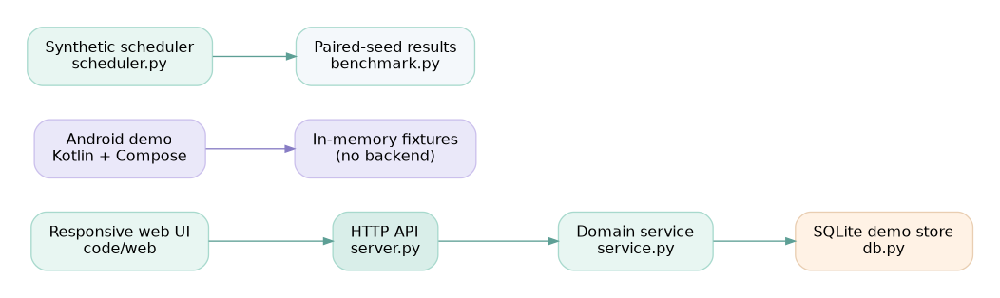
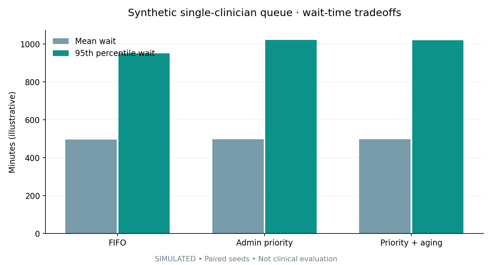

# MobiHeal — Mobile Healthcare & Appointment Management

**A self-contained educational MobiHeal prototype with a research-style repository structure.**

> **Includes:** responsive web UI, local Python/SQLite API, independent Kotlin/Jetpack Compose Android demo, deterministic synthetic scheduling simulation, visualizations, automated tests, and example results.
>
> **Status:** working local Python prototype; Android source is supplied for Android Studio import but was not compiled in this environment.
> **Important:** NOT a clinical product, medical device, real prescription platform, or production service. Use *fictional* data only.

Inspired by the **organization** of the supplied E-COCSF repository (`code/`, `figs/`, `graphs/`, `results/`, and a detailed README). MobiHeal is a different application, with newly written implementation and explicitly synthetic results. **No E-COCSF models, experiment data, or source files are reused.**



---

## What works

- **Appointments:** view clinician directory, book a dated half-hour slot, reject double-booking, cancel a scheduled visit.
- **Care queue:** check in a booked appointment and mark it complete using validated status transitions.
- **Health log:** add and list self-entered measurements (heart rate, temperature, weight, steps) with basic input bounds, not clinical interpretation.
- **Care documents:** browse an explicitly fake sample prescription record. No actual issuing or signing.
- **Local persistence:** SQLite keeps the web demo's synthetic bookings and measurements between starts.
- **Android demo:** a separate, offline, in-memory Kotlin + Jetpack Compose UI with corresponding flows, requiring Android Studio to compile.
- **Evaluation:** reproducible comparison of three synthetic, nonclinical appointment queue policies (FIFO, administrative priority, priority with aging).
- **Testing:** standard-library Python unit/integration tests, an automated CI workflow, and reproducible CSV/JSON result files.

This project has **no login, real patient accounts, Firebase integration, real-time teleconsultation, payments, cloud synchronization, or clinical triage**. Those require separate production architecture and security reviews.

## Repository structure

```text
MobiHeal-main/
├── README.md
├── LICENSE
├── pyproject.toml
├── .github/workflows/test.yml
├── code/
│   ├── mobiheal/
│   │   ├── db.py                  # SQLite schema + synthetic seed data
│   │   ├── service.py             # Booking, status transitions, measurements
│   │   ├── server.py              # Local HTTP API, static frontend server
│   │   ├── scheduler.py           # Nonclinical scheduling experiment
│   │   └── benchmark.py           # CSV/JSON paired-seed benchmark
│   ├── web/
│   │   ├── index.html
│   │   ├── styles.css
│   │   └── app.js
│   └── scripts/
│       └── make_figures.py        # Regenerate benchmark graphs
├── android/                      # Independent Kotlin Compose companion
│   ├── app/src/main/java/com/mobiheal/demo/MainActivity.kt
│   ├── app/src/main/AndroidManifest.xml
│   └── README.md
├── tests/
│   ├── test_service.py
│   └── test_scheduler.py
├── figs/
│   ├── architecture.dot
│   └── architecture.png
├── graphs/
│   ├── wait_tradeoff.png
│   ├── priority_wait.png
│   └── seed_robustness.png
├── results/
│   ├── benchmark_aggregate_results.csv
│   ├── benchmark_episode_results.csv
│   ├── benchmark_results.json
│   └── manifest.json
└── docs/
    ├── ARCHITECTURE.md
    └── BENCHMARK.md
```

## Quick start — local web application

Requirements: **Python 3.10+**. The API, frontend, and tests have **zero external Python dependencies**.

```bash
# Extract the ZIP, then:
cd MobiHeal-main/code
python -m mobiheal.server
```

Open **http://127.0.0.1:8765**. The app automatically seeds a local `code/data/mobiheal.sqlite` demo database. The UI can switch between two fictional patients. The queue tab simulates a clinic-facing view; it has *no real role access control*. Do not expose the service to the network.

To reset the demo database, stop the server and remove `code/data/mobiheal.sqlite` (and SQLite `-wal` or `-shm` files if present), then restart.

### Web demo workflow

1. Open **Overview** and see the fictional care team and upcoming visits.
2. Select **Book appointment**, choose a clinician, date, and half-hour slot. Conflicting active bookings are rejected.
3. Open **Appointments** to view or cancel a visit.
4. Open **Health log** to record a synthetic measurement.
5. Open **Care queue** to check in a visit and mark it complete.
6. Open **Documents** to inspect the static, *invalid for medical use* sample record.

## Android demo

See [android/README.md](android/README.md). Open `android/` in Android Studio and run the `app` configuration. The Android project is a **standalone in-memory offline demonstration**; it does not share appointments with the Python SQLite API. You need Android SDK 35 and a compatible Gradle installation or Android Studio tooling. No Gradle wrapper binary is included. No Firebase credentials are needed.

## Run tests

From the repository root:

```bash
python -m unittest discover -s tests -v
```

Tests cover schema seeding, appointment conflicts, invalid input, time-zone handling, appointment status transitions, measurement ranges, HTTP endpoints, synthetic benchmark determinism, and output generation.

## Reproduce the synthetic benchmark

```bash
cd code
python -m mobiheal.benchmark --out_dir ../results --seeds 20 --cases 150
# Optional for PNG regeneration: python -m pip install matplotlib
python scripts/make_figures.py
```

This is **not** a hospital benchmark or healthcare service-performance measurement. It is a toy queue model with fictitious arrivals, durations, and administrative priority labels. The simulation is intentionally congested to make policy tradeoffs visible. See [the full methodology](docs/BENCHMARK.md).

| Output | Meaning |
| --- | --- |
| `results/benchmark_episode_results.csv` | Policy × seed records, `20 × 3` rows |
| `results/benchmark_aggregate_results.csv` | Aggregate metrics across matched seeds |
| `results/benchmark_results.json` | Machine-readable run records |
| `results/manifest.json` | Reproduction parameters and explicit disclaimer |
| `graphs/wait_tradeoff.png` | Simulated average and p95 waits |
| `graphs/priority_wait.png` | Simulated wait for highest administrative category |
| `graphs/seed_robustness.png` | Synthetic between-seed variability |



## Code tour

### `code/mobiheal/service.py`

Implements booking with UTC-normalized, timezone-aware future slots; a DB-level unique active-slot constraint; guarded appointment transitions; input-bounded measurement entry; and demo listing endpoints.

### `code/mobiheal/server.py`

A local threaded HTTP server using the Python standard library. Serves HTML/CSS/JS alongside small JSON endpoints. By design it accepts only loopback binding; there is no authentication or API key mechanism.

### `code/mobiheal/scheduler.py` and `benchmark.py`

Generate seeded synthetic arrivals and compare work-conserving FIFO, administrative-priority, and priority-aging disciplines under the same workload for each seed. These priorities are **not** based on clinical need. Every benchmark artifact and graph is marked synthetic.

### `android/app/src/main/java/com/mobiheal/demo/MainActivity.kt`

A Jetpack Compose local demo with overview, appointment management, measurements, sample documents, and a queue tab. It uses in-memory synthetic fixtures to keep the APK source independently runnable without a server or cloud account.

## Medical, privacy, and deployment limitations

MobiHeal is an educational prototype. It does **not** make clinical recommendations, diagnose symptoms, issue valid prescriptions, provide authenticated provider access, or store patient data safely for real use. Its demo patients and records are fictional. The web application has no authentication, encryption at rest, audit trail, or fine-grained access control; never enter PHI or run it on a public interface.

Production work would require a threat model, secure authentication and authorization, consent, privacy/legal compliance applicable to the deployment jurisdiction, clinician validation, access logging, encryption, recovery procedures, and comprehensive testing. The benchmarks do not establish safety or clinical efficacy.

## Attribution and license

This is a newly authored educational example; its repository layout was patterned after the supplied E-COCSF archive, and its application concept uses the generic MobiHeal telehealth name. A public student Kotlin/Firebase project also describes itself as Mobiheal ([Mobile-Telehealth-System](https://github.com/Nhathuy1305/Mobile-Telehealth-System)); **this archive is not a fork, copy, or verified reproduction of that codebase**, and is not represented as affiliated with it.

This original demonstration code is released under the [MIT License](LICENSE). Any future additions or third-party assets must retain their own applicable notices.
